# Deleted Files Recovery Program — User Guide

[العربية](GUIDE.md) · [PDF copy for printing](GUIDE-en.pdf) · [Download the program](README.md)

A simple illustrated explanation of every part of the program. The red numbers in each picture match the steps written under it. The same guide is inside the program, from the “User Guide” button at the top.

## Contents

1. [Getting started: the Dashboard](#start)
2. [Opening a disk image file](#openimage)
3. [File recovery: the kinds of scan](#scan)
4. [Results and getting files back](#results)
5. [Recovering lost partitions](#lost)
6. [Copy Disk to File (Image)](#imaging)
7. [Recent scans](#recent)
8. [Partition Manager](#partitions)
9. [Copy Disk to Disk](#clone)
10. [Utilities](#tools)
11. [Real capacity check (fake stick?)](#capacity)
12. [Surface test](#surface)
13. [Disk health (S.M.A.R.T)](#smart)
14. [Disk speed test](#benchmark)
15. [Space analyzer](#space)
16. [Duplicate files](#dups)
17. [BitLocker (disk encryption)](#bitlocker)
18. [Recycle Bin](#recycle)
19. [Hex viewer](#hex)
20. [Settings, updates and license](#settings)
21. [Troubleshooting and reports](#troubleshoot)

## 1. Getting started: the Dashboard

Every recovery starts here. The screen lists every disk connected to the PC (internal disks, USB sticks, memory cards) and each disk's partitions with their letter, size, file system and free space, plus the disk's state (healthy or not) and kind (NVMe, SSD or USB). The usual path: pick the disk the files were deleted from, pick the kind of scan, then press “Start scan”.

1. In “Discovered Disks”, pick where the files were: the “Whole disk” row scans all of the disk (including deleted partitions); a partition row (such as D:) scans only that partition and is faster.
2. Pick the kind of scan: “Quick scan” for recently deleted files on a healthy partition, “Deep scan” after formatting or damage, or “Search lost partitions” when a whole partition disappeared.
3. Press “Start scan” to go to the matching scan screen.
4. The partition map draws the chosen disk's partitions to scale; click one in the map to pick it directly.
5. Shortcuts for the same actions: quick scan, deep scan, search lost partitions, and open a disk image saved earlier.

> **Tips:**
> - The golden rule: do not save anything new on the disk the files were deleted from until you are done — no downloads, no programs, not even the recovered files. Every new write may take the place of a deleted file and lose it for good.
> - If a disk or stick you just plugged in is missing, press “Refresh”. Each disk appears once, with its partitions under it.
> - The “System disk” badge marks the disk Windows runs from, and “Windows partition” is C:. You can scan and recover from them, but save the recovered files to another disk.
> - A disk that is not healthy or makes noises: copy it to a file first (see “Copy Disk to File”), then scan the copy.

[↑ Back to contents](#contents)

---

## 2. Opening a disk image file

A disk image is a complete copy of a disk kept in one file — made with “Copy Disk to File”, or with another tool (raw .img, .dd and .bin files). Open it here and scan and recover from it exactly as if it were the disk, without touching the original disk.

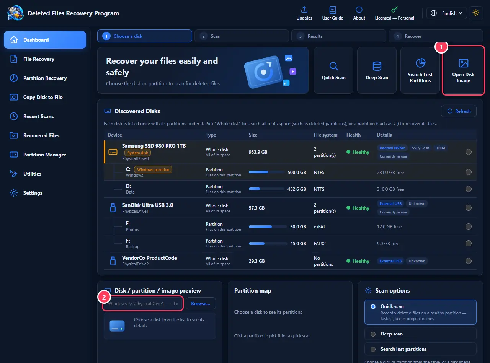

1. Press “Open Disk Image” and choose the image file.
2. The file's path appears in the preview box. Then pick the kind of scan and press “Start scan” as usual.

> **Tips:**
> - You can also type the path of a file or a disk by hand in the same box (such as \\.\PhysicalDrive1).
> - Scanning an image file is faster and safer than scanning a weak disk over and over.

[↑ Back to contents](#contents)

---

## 3. File recovery: the kinds of scan

After picking a disk you get the scan screen. Each method suits a different case, and picking the right one saves a lot of time:

1. Quick scan: reads the file system's records (NTFS, FAT32, exFAT, ext4 or HFS+), so files come back with their original names, folders and dates. Takes seconds to minutes. Use it when the files were deleted recently and the disk was not formatted.
2. Copy the disk to a file first: when the disk is weak, noisy, very slow or drops off by itself — copy all of it to a file on a healthy disk, then scan the copy instead of the tired disk.
3. Recover a deleted partition: when a whole partition is gone (for example drive D: disappeared, or the disk shows as “Unallocated” or “RAW”).

1. Deep scan: reads the whole disk sector by sector and recognises files by their “signature” (the start of each kind: JPG and PNG photos, PDF, Word and Excel documents, MP4 video, ZIP archives…). It finds files even after formatting or file-system damage, but it is slower (hours for a big disk) and cannot know the original names, so it numbers them.
2. Press “Start deep scan”. “Skip bad and slow areas” matters for damaged sticks and disks: it steps over places that cannot be read instead of getting stuck on them.

1. The progress bar: the percentage, how much of the total has been read, and the estimated time left.
2. “Cancel scan” stops it and shows what was found so far. A deep scan saves its position as it goes, so if the program closes or the power fails, it offers to continue from where it stopped.

> **Tips:**
> - Always try the quick scan first; if your files are not there (or have no names), try the deep scan.
> - Choosing the “Whole disk” for a deep scan searches everywhere, even areas where deleted partitions used to be.
> - Avoid heavy work on the PC during a deep scan; let it run and do not switch off.

[↑ Back to contents](#contents)

---

## 4. Results and getting files back

After a scan you see every file found, with its name, size, type and state. Find yours, preview them to make sure they are fine, then recover them — one file or many at once — to another disk.

1. Ready categories: All, Images, Documents, Video, Audio, Archives — click one to show only that. “Preview images” shows pictures as thumbnails so you can spot yours by eye.
2. “Generate preview” shows the chosen file's content (picture, text or file details) before you recover it.
3. “Recover” saves the chosen file, or every file you ticked ✓.
4. “Final report screen” to export the list of files found.

1. Search by file name or extension (such as jpg or pdf), and filter by type and file state. Click a column title to sort the table.
2. Tick ✓ every file you want, to recover many at once.
3. Results tree: “Good” means the file is most likely whole, “Partial” that part of it may be damaged or overwritten, and “Unreadable” that its place on the disk could not be read.

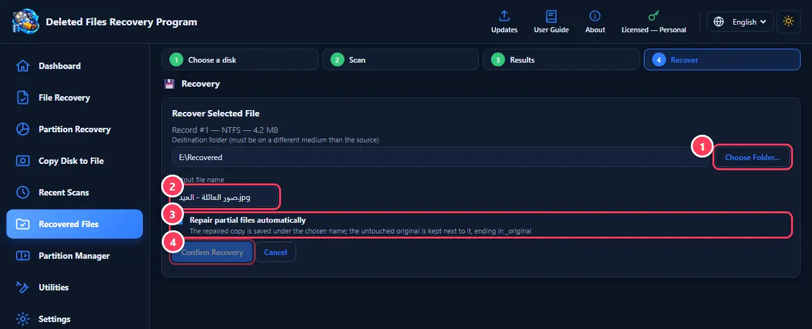

1. “Choose folder…”: where to save, on a disk other than the one you are recovering from — the program warns you if you pick the same disk.
2. The output file name: you can change it before saving.
3. “Repair partial files automatically”: tries to repair a partial file, and keeps the original next to it with a name ending in _original.
4. “Confirm recovery” saves the file in the folder you chose.

1. When several files are ticked: choose a folder on another disk.
2. Press “Start bulk recovery”. A progress bar shows, partial files are repaired automatically, and at the end you get a summary of what worked and what did not.

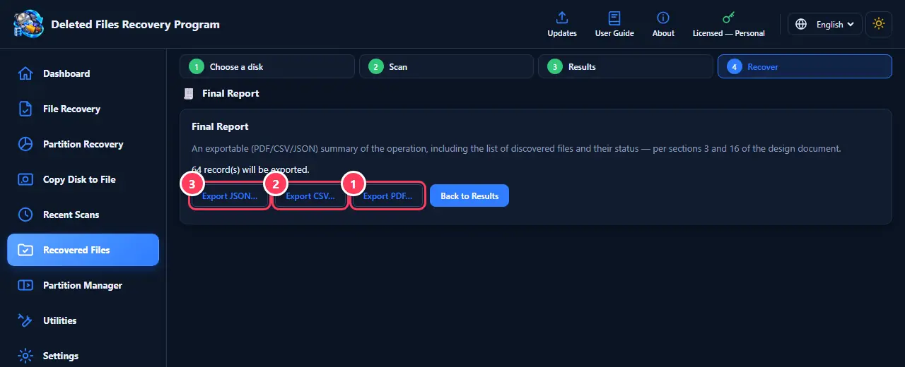

1. “Export PDF…”: a readable report ready to print or send.
2. “Export CSV…”: a table that opens in Excel to sort and filter the files.
3. “Export JSON…”: for other programs and tools.

> **Tips:**
> - Always save recovered files to a different disk — a USB stick, an external disk or another internal disk.
> - If there are very many results, start with a category (such as “Images”) and then search by extension.
> - A “Partial” file may open incomplete (a photo half grey, for example); part of it was overwritten after it was deleted.
> - The last scan's results are saved automatically; get back to them from “Recent Scans”, even after closing the program.

[↑ Back to contents](#contents)

---

## 5. Recovering lost partitions

When a whole partition disappears — deleted by mistake in Disk Management, the disk showing as “Unallocated” or “RAW” with Windows asking to format it, a partition table damaged by a power cut or a virus, or a disk re-partitioned — the data is usually still there, but Windows no longer knows where. This screen reads the whole disk looking for where partitions start (NTFS, FAT32, exFAT, ext4, HFS+), then lets you bring them back.

1. Press “Start search” — the program reads the whole disk without writing anything. How long it takes depends on the disk's size and speed.
2. The partitions found are listed with their type, position and size. “Scan this partition” opens a file scan inside it so you recover the files to another disk — the safest way.
3. “Restore partition” puts it back in the partition table so Windows shows it with its letter and files, as it was.

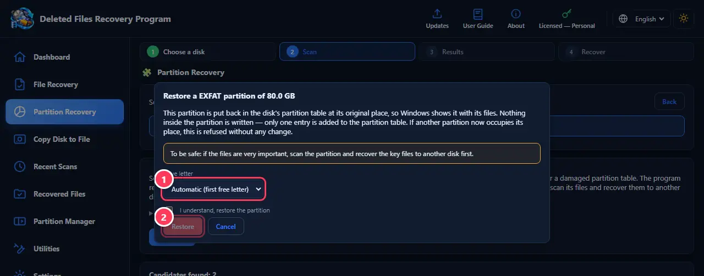

1. Pick the partition's letter from the list, or leave it “Automatic” for Windows to take the first free one.
2. Tick “I understand, restore the partition” and press “Restore”. Only one entry is added to the partition table; nothing inside the partition itself is written. If another partition now occupies its place, it is refused without any change.

> **Tips:**
> - If the files are very important: scan the partition and recover the key files to another disk first, then restore the partition.
> - A partition that is still there shows “Already present” and needs no restoring.
> - “Advanced options” holds the search precision: leave it at 1 MB; make it smaller (such as 512) only for a very old disk or when nothing is found — the search becomes much slower.
> - If Windows asks to “format” the disk when you plug it in, press “Cancel” — formatting can wipe out the chance to recover.
> - ext4 and HFS+ partitions (Linux and Mac) are not readable by Windows, so their files are scanned and recovered only.

[↑ Back to contents](#contents)

---

## 6. Copy Disk to File (Image)

Copies the whole disk, sector by sector, into one file on a healthy disk. A weak disk can get worse with every read; here it is read once only, then you scan and recover from the file as often as you like. Bad sectors do not stop the copy: the program steps over them and notes where they are.

1. “Choose file…”: where to save the image, on another disk with room for the whole disk being copied.
2. Press “Start imaging” and wait until it finishes. Then press “Scan the image now” to scan the file straight away.

> **Tips:**
> - To open a saved image later: Dashboard → “Open Disk Image”.
> - How it differs from “Copy Disk to Disk”: here the result is a file you scan and recover from inside the program, and no disk is erased; “Copy Disk to Disk” writes a ready-to-use copy onto another disk (erasing it) for use straight away in Windows.
> - The file is as big as the whole disk, even when the disk is nearly empty.

[↑ Back to contents](#contents)

---

## 7. Recent scans

The program saves the last scan's results automatically, so you can return to them without scanning again — even after closing the program or restarting the PC. Very handy after a deep scan that took hours.

1. You see the disk that was scanned and how many files were found. “View results” takes you back to the file list; “Discard” forgets these saved results (the disk is not touched).

> **Tips:**
> - When you start the program after an unfinished scan, it offers to continue it from where it stopped.

[↑ Back to contents](#contents)

---

## 8. Partition Manager

To organise disks: split a partition in two, shrink or extend one, move it, merge two, create a new one from free space, format it and change its label and letter, and more. Everything goes through Windows' own storage service, and the program shows what the disk will look like before running anything. On the Windows (system) disk only what Windows allows while running is available.

1. “Partition Manager”: change any disk's partitions.
2. “Copy Disk to Disk”: copy a whole disk onto another.
3. “Copy Disk to File”: copy a whole disk into one file (an image) before recovering.

1. Pick the disk from the list, then click a partition or a “Free” area in the map or the table to select it.
2. The main operation cards for the selected partition: split in two, shrink, extend, move. A faded card is not possible right now, and says why.
3. Quick buttons: format, rename, change letter, open the partition in Explorer, “More”, and delete the partition.

1. Move the slider or type the size in GB (or press “Quarter” or “Half”). You can also pick the new partition's file system and label.
2. The coloured bar shows the disk after the operation, with the exact sizes under “Result” — before anything changes.
3. Press “Run”. A progress bar shows; do not turn the PC off or unplug the disk during the operation.

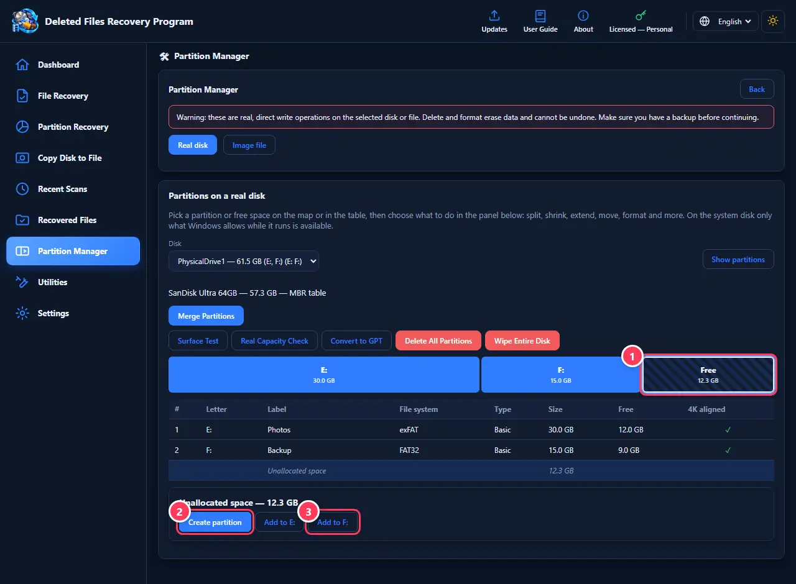

1. Click a “Free” (unallocated) area in the map.
2. “Create partition”: a new partition in this space — even on the Windows disk.
3. “Add to X:”: joins the space to an existing partition. It works even with another partition (such as Recovery) in between: that one is moved automatically, and you see what will happen before anything runs.

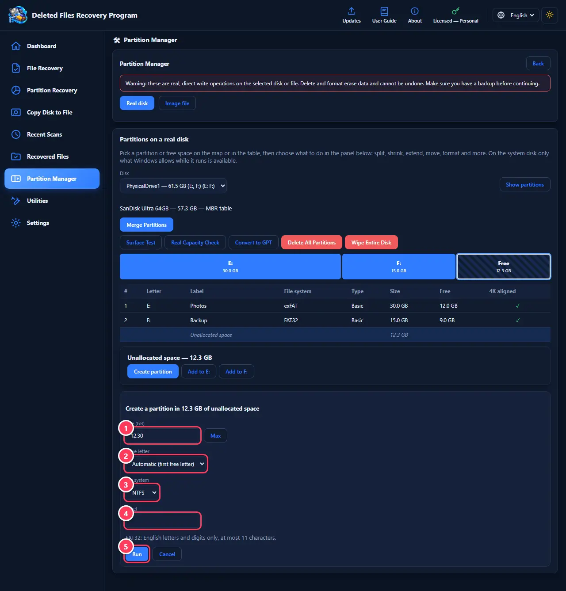

1. The size in GB; “Max” takes all the space.
2. Drive letter: pick any free letter, or “Automatic”.
3. File system: NTFS for internal and big external disks, exFAT for sticks used with other devices and files over 4GB, FAT32 for old devices.
4. The partition's label (optional), as shown in “This PC”.
5. “Run”: the partition is created, formatted and shows up with its letter at once.

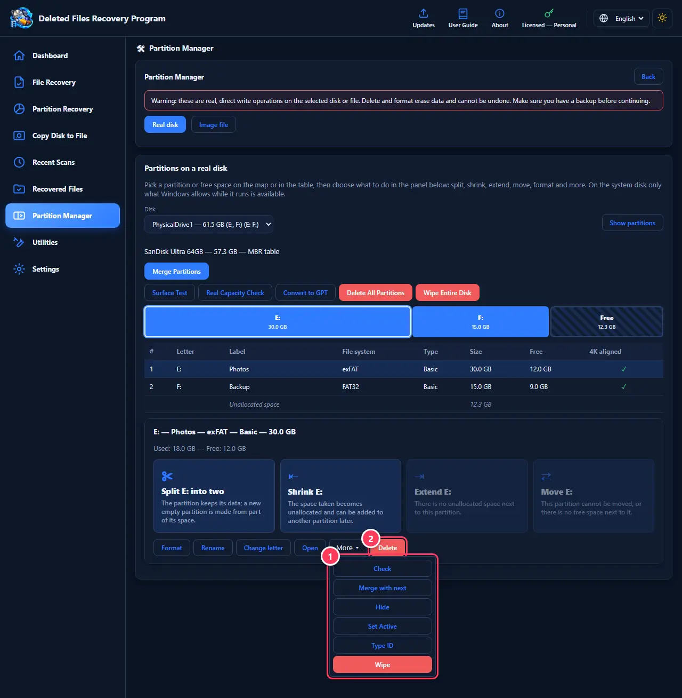

1. The “More” menu holds the less common operations: check and repair the file system, merge with the next partition, hide or unhide the partition, set it active (for old MBR disks), change the partition type, and secure wipe, which overwrites the whole partition so its files can never be recovered.
2. “Delete”: removes the partition after you confirm. It can usually be brought back later from “Partition Recovery”, as long as no new data was written over it.

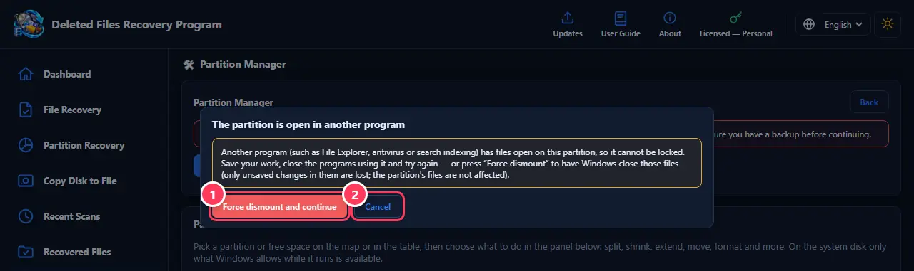

1. This window appears when another program (such as Explorer, antivirus or search indexing) has files open on the partition while it is being moved or extended. Save your work and close those programs, then try again — or press “Force dismount and continue” so Windows closes those files and the operation carries on. Only unsaved changes in them are lost; the partition's files are not affected.
2. “Cancel” stops the operation without any change.

> **Tips:**
> - Back up important files before moving or resizing a partition, and do not turn the PC off during the operation.
> - Whole-disk buttons above the map: “Merge partitions”, “Surface test”, “Real capacity check”, “Convert to GPT/MBR”, “Delete all partitions” and “Wipe the whole disk”. The last one erases everything for good.
> - If Windows allows shrinking a partition by less than its free space, the program explains why (a file at the end of the partition that will not move, such as the page file) and offers a fix when one exists.
> - The first time the screen opens you may see “Updating the disk's information…” for a second; the buttons work right after.
> - If “The partition is open in another program” appears, close the programs using the partition and try again — or save your work and press “Force dismount and continue”.
> - The “4K aligned” column should show ✓; a misaligned partition is slower on modern SSDs.

[↑ Back to contents](#contents)

---

## 9. Copy Disk to Disk

Copies a whole data disk (every partition and file) directly onto another disk, sector by sector, so the second disk becomes an exact, ready-to-use copy. The copy gets new identifiers so both disks work together in the same PC. Useful for moving to a bigger disk, replacing a disk that is getting weak, or keeping a ready backup.

1. Source disk: the one to copy.
2. Target disk: everything on it is erased and it becomes a copy of the source; it must not be smaller. Tick the confirmation, then “Start copy”.

> **Tips:**
> - Double-check the target disk — its content is permanently erased. Check its name and size, not only its letter.
> - The Windows disk cannot be the source or the target here.
> - If the target is bigger than the source, the rest is left as free space you can add later in “Partition Manager”.
> - Only want to save the disk into a file to scan and recover from? Use “Copy Disk to File”.

[↑ Back to contents](#contents)

---

## 10. Utilities

Tools to check disks' and sticks' health and speed and tidy up their space: real capacity check, surface test, S.M.A.R.T, speed test, space analyzer, duplicate files, BitLocker, Recycle Bin and the Hex viewer. Each has its own section in this guide.

1. Real capacity check: is the USB stick or memory card genuine or fake?
2. Surface test: finds damaged or slow areas.
3. S.M.A.R.T: the disk's health, temperature and wear.

> **Tips:**
> - Read-only tools (surface test, S.M.A.R.T, space analyzer, Hex) change nothing on the disk. Tools that write (capacity check, write test) ask for your consent first and warn you that they erase data.

[↑ Back to contents](#contents)

---

## 11. Real capacity check (fake stick?)

Some USB sticks and memory cards are sold with a fake size: labelled 32GB but holding only 8 or 16. They work at first, then files get corrupted or formatting stops halfway. This check writes test data across the stick and reads it back to reveal the real size in minutes, then fixes the stick to work safely at its real size.

1. Pick the stick, tick “I understand all data will be erased” (copy your files off it first), then “Start check”.
2. The verdict: genuine, fake with its real size, partly damaged, or “stopped responding”.
3. “Set the real capacity on the stick”: the size is filled in from the check. Tick the box and press “Create and format the partition”, and the stick uses only its real capacity and works safely. If the stick dropped off during the check, plug it back in and press “Refresh list” first.

> **Tips:**
> - A fake stick set to its real capacity is safe to use, but do not trust it with important files without another copy.

[↑ Back to contents](#contents)

---

## 12. Surface test

Reads the whole disk and draws a map: green good, yellow slow, red damaged. Very slow reads are an early sign of a disk that is starting to fail. It changes nothing on the disk.

1. Pick the disk and press “Start test”. You can stop it at any time.
2. The summary: how many areas are good, slow and damaged, and where the damaged ones are.

> **Tips:**
> - If damaged areas show up, copy your important files off the disk right away, then copy the disk to a file before any recovery attempt.
> - Below the test there is the more thorough “Write-and-Verify Test”: it writes over the whole disk and reads it back — it erases all data, so use it only on an empty or new disk.

[↑ Back to contents](#contents)

---

## 13. Disk health (S.M.A.R.T)

What the disk records about itself over its life: whether it is healthy, its temperature, its wear (for SSDs), its hours of use, and read and write errors. A quick look tells you whether the disk needs replacing soon.

1. “Healthy” means fine. Watch out for a temperature always above 60°, wear close to 100%, or read or write errors — these are signs to back up your files.

> **Tips:**
> - Some USB sticks and card readers do not report S.M.A.R.T, so it shows “not available” — that is normal.

[↑ Back to contents](#contents)

---

## 14. Disk speed test

Measures the real read and write speed of a disk or stick with a temporary file deleted afterwards, without touching your files. Useful to see whether a stick is as fast as its label says, or whether a disk has become slower than usual.

1. Pick the partition and the test size, then “Start”.
2. The results: sequential speed (what matters when copying big files such as films) and random speed (what matters for running programs and Windows).

> **Tips:**
> - Close other programs while testing for an accurate result.

[↑ Back to contents](#contents)

---

## 15. Space analyzer

Shows which folders and files use up the disk, largest first, so you know what to delete or move when the disk is full.

1. Pick the drive or folder and press “Analyze”.
2. Folders are listed largest first with each one's share. Click one to open it, and “Largest files” for the biggest files on the whole drive.

> **Tips:**
> - The analyzer only reads and deletes nothing; delete what you want yourself in Explorer.

[↑ Back to contents](#contents)

---

## 16. Duplicate files

Finds files with identical content even when their names or places differ, and frees space by moving the extra copies to the Recycle Bin.

1. Pick the drive or folder and press “Find duplicates”.
2. In each group the extra copies are ticked automatically and one copy is kept; review them (you can change which copy stays), then move them to the Recycle Bin.

> **Tips:**
> - Files go to the Recycle Bin, not deleted for good, so you can undo from Windows' Recycle Bin.

[↑ Back to contents](#contents)

---

## 17. BitLocker (disk encryption)

Shows whether a partition is encrypted with BitLocker and its state, and lets you lock and unlock it, suspend protection, and turn encryption on or off. A locked encrypted partition cannot be scanned or recovered from until it is unlocked.

1. Encryption, protection and lock status, and how much is encrypted, for each partition.
2. Buttons to lock and unlock, suspend, and turn encryption off.

> **Tips:**
> - Keep the Recovery Key somewhere safe before turning encryption on — without it the partition cannot be opened if you forget the password.

[↑ Back to contents](#contents)

---

## 18. Recycle Bin

Shows what is in Windows' Recycle Bin for each drive, with each file's original path and deletion date, and gets any of them back — even when the bin does not show on the desktop.

1. Pick the drive and press “Scan Recycle Bin”.
2. Press “Recover…” next to a file and choose where to save it.

> **Tips:**
> - If you emptied the bin, the files are no longer here — use a quick scan of the drive to recover them.

[↑ Back to contents](#contents)

---

## 19. Hex viewer

A tool for advanced users: shows the raw bytes of a disk or image file as they are, in hexadecimal with the text beside them. Useful to check where a partition starts or what a given area holds. It writes nothing.

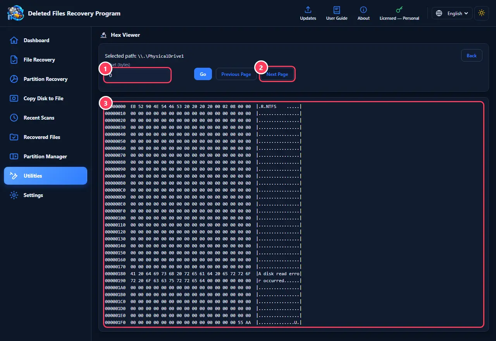

1. Type the offset (the position in bytes) and press “Show”.
2. “Previous page” and “Next page” to move around.
3. Each line: its position, 16 bytes in hex, then the matching text. The picture shows the start of an NTFS partition with its 55 AA signature at the end of the sector.

> **Tips:**
> - Open it from “Utilities” → “Hex” after picking the disk on the Dashboard.

[↑ Back to contents](#contents)

---

## 20. Settings, updates and license

The program's language and look, the log panel, checking for updates, the user guide, the diagnostic report, the version, and license management.

1. Language: Arabic or English; it stays as you chose after updates.
2. Look: light or dark.
3. “Check for updates”: tells you when a newer version is out, and downloads and installs it after checking the file is intact.
4. Diagnostic report: “Create diagnostic report…” and “Report a problem” — see “Troubleshooting and reports”.

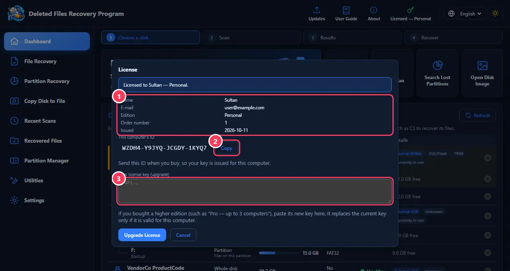

1. Your license details: name, email, edition and date.
2. “Copy” this PC's ID: send it when you buy so you get a key that works on your PC.
3. New license key: if you bought a higher edition (such as “Professional” — up to 3 PCs), paste the key here and press “Upgrade license”.

> **Tips:**
> - When the program starts it tells you automatically if an update is available.
> - The license window opens from the License button (the key) in the top bar, or from Settings.
> - Some features (such as recovery and partition operations) need a license; if the program is not activated, the activation window opens when you use them.

[↑ Back to contents](#contents)

---

## 21. Troubleshooting and reports

The program records every operation you run and its result, and every error in full, in a log that stays after it closes. If something goes wrong, the log and the diagnostic report help you see why, and help the developer fix it in the next update.

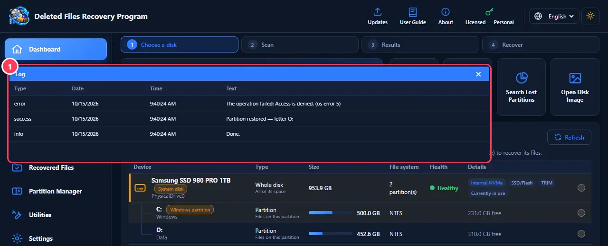

1. The log panel: each event's kind (info, success, error), date, time and text. Open it from Settings → “Show/hide log”.

> **Tips:**
> - To report a problem: Settings → “Create diagnostic report…” saves a text file with your disks, your system and the program's recent errors — no file names or contents. Then “Report a problem” opens the reporting page; attach the report with a description of what happened.
> - The program never sends anything from your PC by itself; you review the report and decide to send it.
> - “The partition is open in another program”: close the programs using the partition, or choose “Force dismount and continue”.
> - A disk does not show up: unplug it and plug it back in, press “Refresh”, and try another USB port or cable.
> - A scan gets stuck at some percentage: the disk is probably damaged there — turn on “Skip bad areas” or copy the disk to a file first.

[↑ Back to contents](#contents)

---
