# Deleted Files Recovery Program — User Guide

[العربية](GUIDE.md) · [PDF copy for printing](GUIDE-en.pdf) · [Download the program](README.md)

A simple illustrated explanation of every part of the program. The red numbers in each picture match the steps written under it. The same guide is inside the program, from the “User Guide” button at the top.

## Contents

1. [Getting started: the Dashboard](#start)
2. [File recovery: the kinds of scan](#scan)
3. [Results and getting files back](#results)
4. [Recovering lost partitions](#lost)
5. [Copying a disk to a file (Image)](#imaging)
6. [Recent scans](#recent)
7. [Partition Manager](#partitions)
8. [Disk to disk copy](#clone)
9. [Utilities](#tools)
10. [Real capacity check (fake stick?)](#capacity)
11. [Surface test](#surface)
12. [Disk health (S.M.A.R.T)](#smart)
13. [Disk speed test](#benchmark)
14. [Space analyzer](#space)
15. [Duplicate files](#dups)
16. [BitLocker (disk encryption)](#bitlocker)
17. [Recycle Bin](#recycle)
18. [Settings and updates](#settings)

## 1. Getting started: the Dashboard

Every recovery starts here: pick the disk or USB stick the files were deleted from, pick the kind of scan, then press “Start scan”.

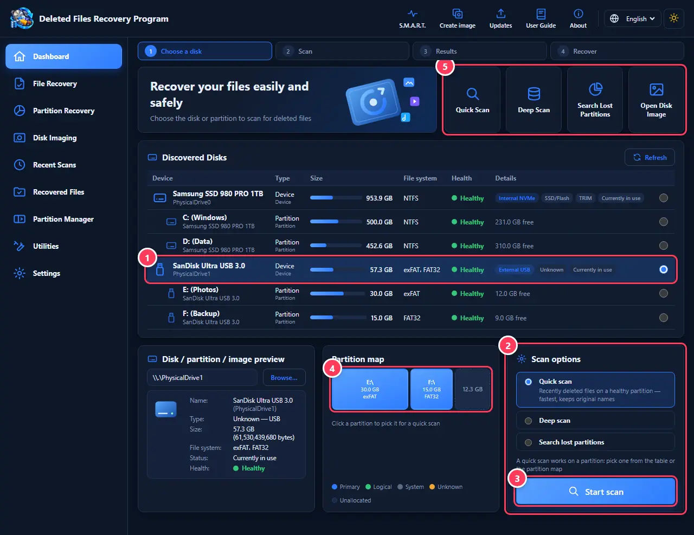

1. In “Discovered Disks”, pick the disk or partition the files were on (for example the USB stick or drive D:).
2. Pick the kind of scan: “Quick scan” for recently deleted files, “Deep scan” after formatting or damage, or “Search lost partitions” when a whole partition disappeared.
3. Press “Start scan”.
4. The partition map shows the chosen disk's partitions; click one to pick it directly.
5. Shortcuts for the same scans, and a button to open a disk image saved earlier.

> **Tips:**
> - Do not save anything new on the disk the files were deleted from until you finish: every new file may overwrite a deleted one.
> - If a disk you just plugged in is missing, press “Refresh”.

[↑ Back to contents](#contents)

---

## 2. File recovery: the kinds of scan

After picking a disk you get the scan screen. Choose what fits your case:

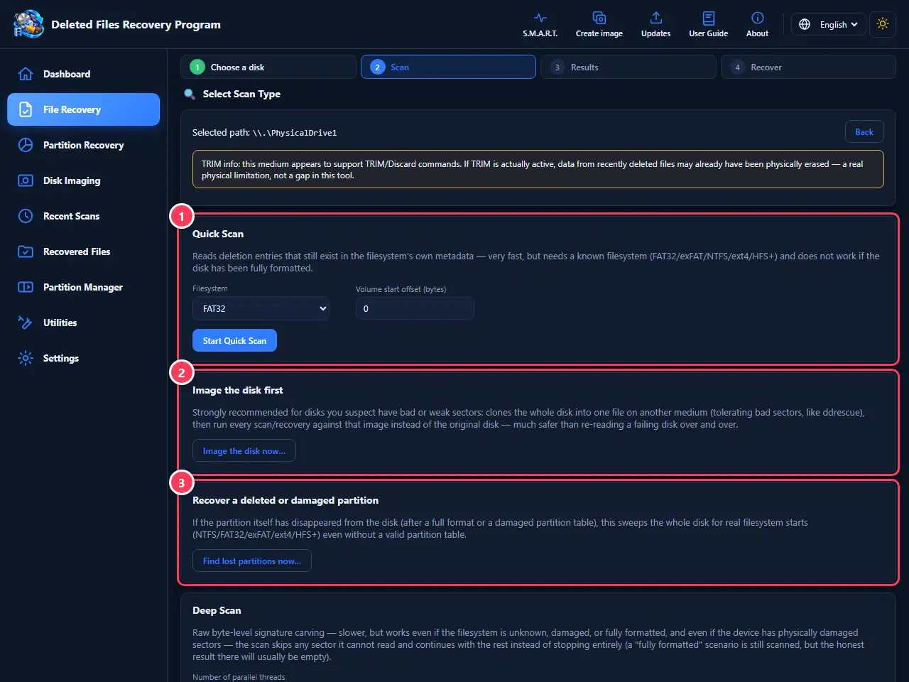

1. Quick scan: the fastest, brings files back with their original names and folders. Use it when the files were deleted recently and the disk was not formatted.
2. Make an image of the disk first: important when the disk is weak, noisy or very slow. It copies the whole disk to a file, then you scan the copy instead of the tired disk.
3. Recover a deleted partition: when a whole partition is gone (for example drive D: disappeared).

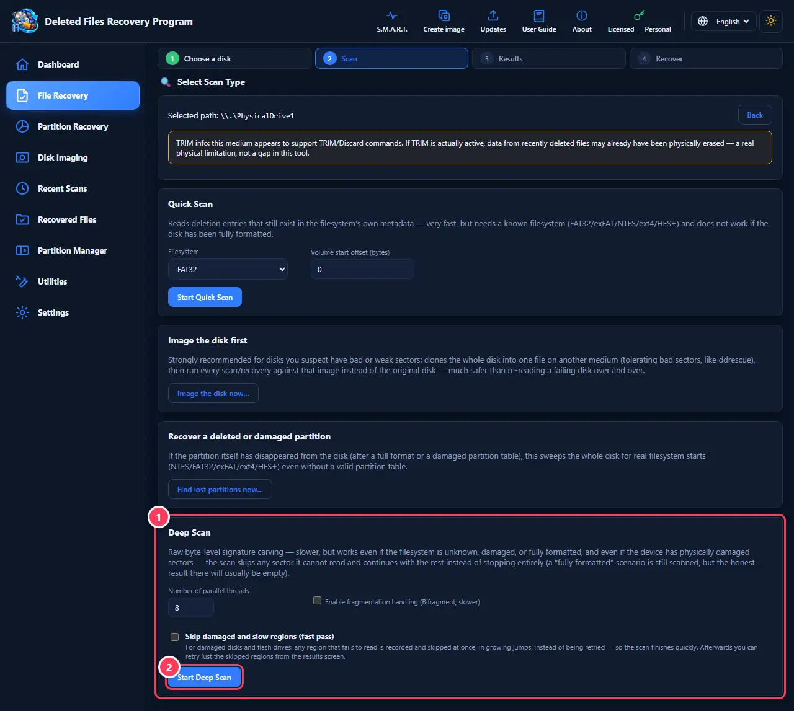

1. Deep scan: searches the whole disk for files by their “signature” (photos, documents, video…). It works even after formatting or when the file system is damaged, but it is slower and cannot know the original names.
2. Press “Start deep scan”. “Skip bad and slow areas” helps with damaged sticks and disks.

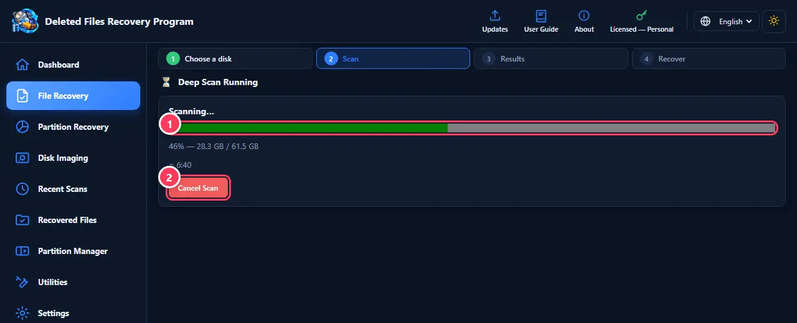

1. Progress and the estimated time left.
2. “Cancel scan” stops it. A deep scan can be resumed later from where it stopped.

> **Tips:**
> - Always try the quick scan first; if your files are not there, try the deep scan.

[↑ Back to contents](#contents)

---

## 3. Results and getting files back

After a scan you see the files that were found. Find yours, preview them, then recover them to a safe place.

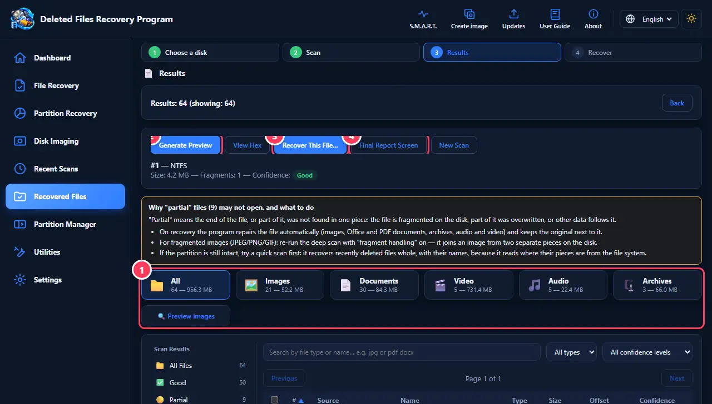

1. Ready categories: All, Images, Documents, Video, Audio, Archives — click one to show only that. “Preview images” shows them as thumbnails.
2. “Generate preview” shows the chosen file's content before recovering it.
3. “Recover” saves the chosen file (or every checked file).
4. “Final report screen” exports the file list as PDF or CSV.

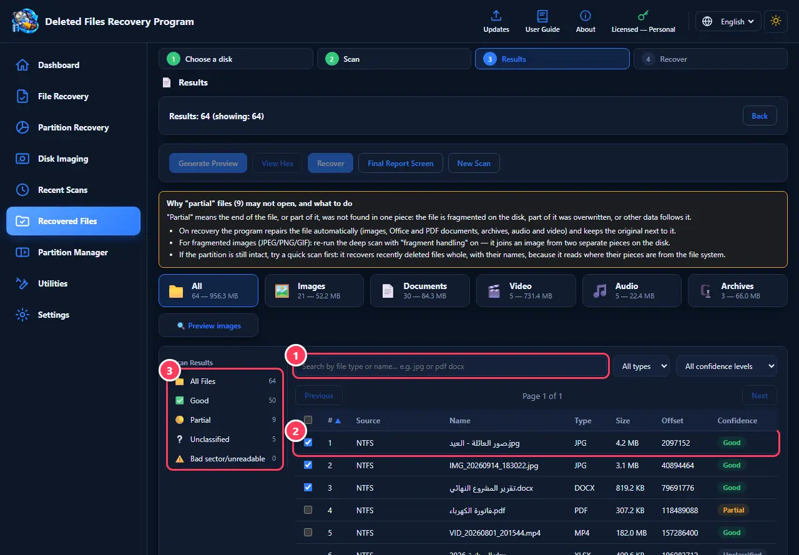

1. Search by file name or type (such as jpg or pdf), and filter by type and file state.
2. Tick ✓ every file you want, to recover many at once.
3. Results tree: “Good” means the file is most likely whole, “Partial” that part of it may be damaged or overwritten.

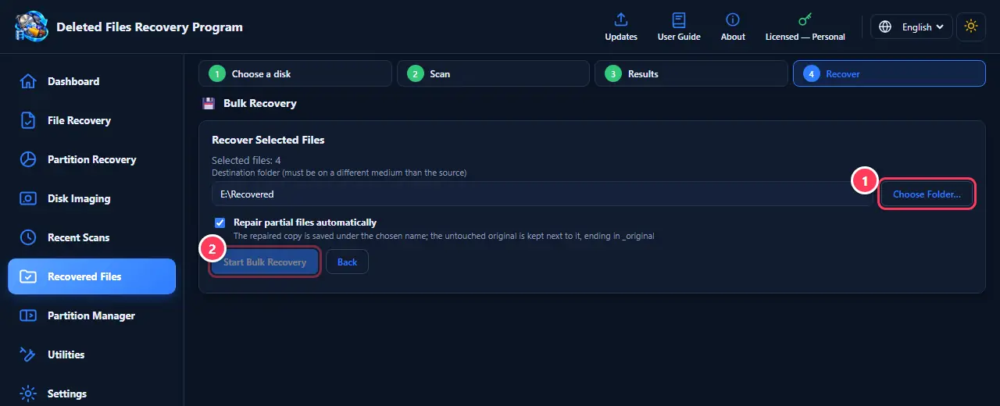

1. Choose a folder to save to on another disk (not the one you are recovering from).
2. Press “Start bulk recovery”. The program tries to repair partial files automatically and keeps the original next to each.

> **Tips:**
> - Always save recovered files to a different disk — the program warns you if you pick the same one.

[↑ Back to contents](#contents)

---

## 4. Recovering lost partitions

When a whole partition disappears (a letter like D: is gone, or the disk shows as “unallocated”), the program searches the whole disk for where the old partitions started.

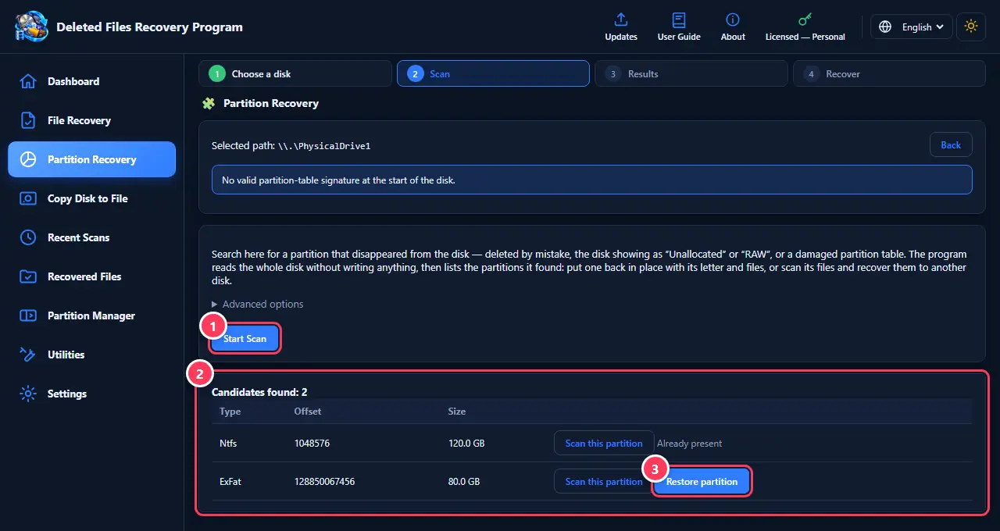

1. Press “Start search” and leave the precision as it is.
2. The partitions found are listed with their type and size. Press “Scan this partition” to browse and recover its files.

[↑ Back to contents](#contents)

---

## 5. Copying a disk to a file (Image)

If a disk is failing or very slow, copy it first to one file on a healthy disk, then scan the file. That way the damaged disk is not read over and over.

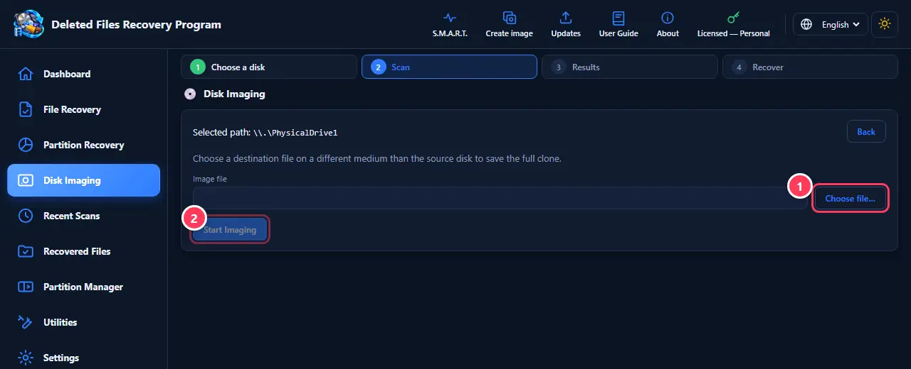

1. Choose where to save the image file, on another disk with enough space.
2. Press “Start imaging”. When it finishes, press “Scan the image now”.

> **Tips:**
> - To open a saved image later: Dashboard → “Open Disk Image”.

[↑ Back to contents](#contents)

---

## 6. Recent scans

The program keeps the results of the last scan, so you can return to them without scanning again, even after closing it.

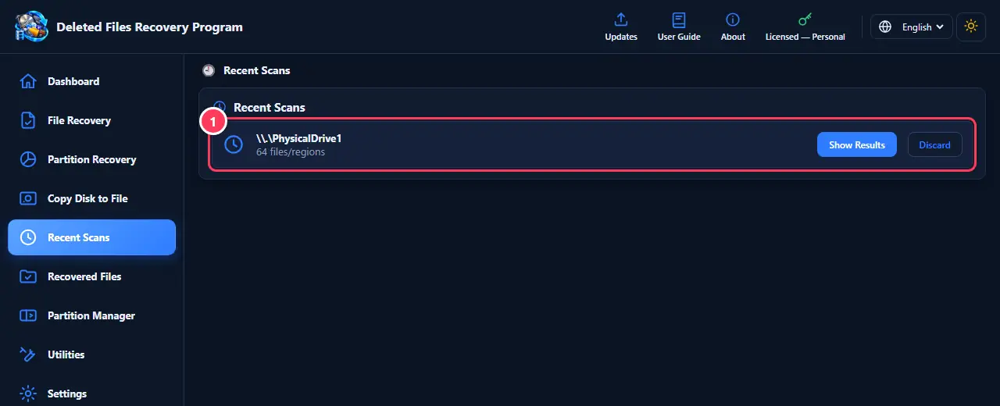

1. “View results” takes you back to the files found; “Discard” forgets these saved results.

[↑ Back to contents](#contents)

---

## 7. Partition Manager

To split a disk, shrink, extend or move a partition, or format it and change its label and letter. Everything goes through Windows' own storage service, and the system disk is protected from risky operations.

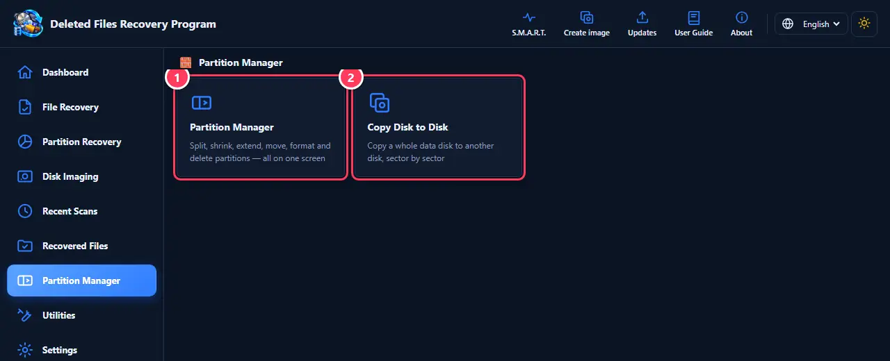

1. “Partition Manager” to change a disk's partitions.
2. “Disk to disk copy” to copy a whole disk onto another.
3. “Create image” to copy a whole disk into one file (an image) before recovering.

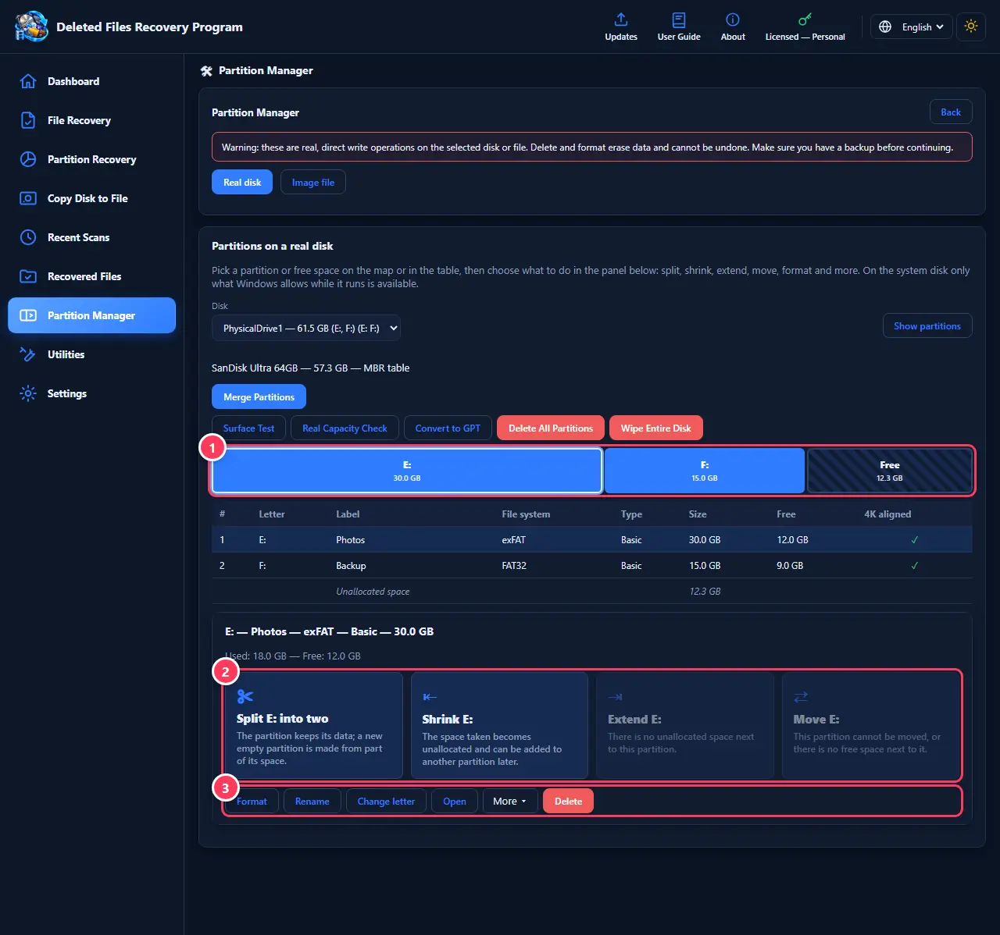

1. Disk map: click a partition or a “Free” area to select it.
2. Operation cards for the selected partition: split in two, shrink, extend, move. A faded card is not possible right now, and says why.
3. Quick buttons: format, rename, change letter, open, “More”, and delete the partition.

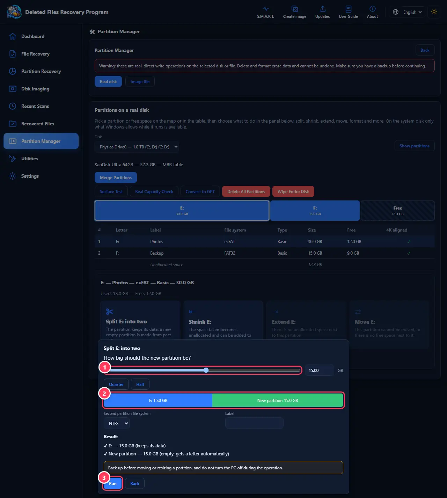

1. Move the slider or type the size in GB (or press “Quarter” or “Half”).
2. The coloured bar shows what the disk will look like before anything is done.
3. Press “Run”. Do not turn the PC off during the operation.

> **Tips:**
> - Back up important files before moving or resizing a partition.
> - If Windows allows shrinking a partition by less than its free space, the program explains why and offers a fix when one exists.
> - Click a “Free” area to add it to any data partition on the same disk, even with another partition (such as Recovery) in between: it is moved automatically, and you see what will happen before anything runs.
> - To make a new partition from a “Free” area (even on the Windows disk), press “Create partition” and pick the letter you want in “Drive letter”.
> - If “The partition is open in another program” appears, close the programs using the partition and try again — or save your work and press “Force dismount and continue”.

[↑ Back to contents](#contents)

---

## 8. Disk to disk copy

Copies a whole data disk (every partition and file) onto another disk — for example when moving to a bigger disk.

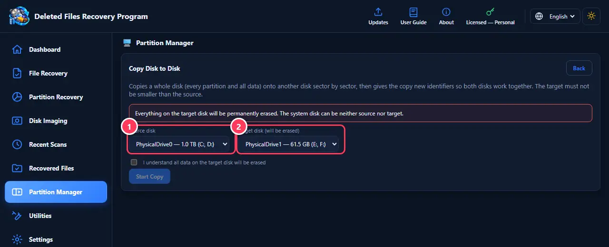

1. Source disk: the one to copy.
2. Target disk: everything on it is erased and it becomes a copy of the source; it must not be smaller.

> **Tips:**
> - Double-check the target disk — its content is permanently erased.

[↑ Back to contents](#contents)

---

## 9. Utilities

Tools to check and tidy up disks and USB sticks. The most useful ones:

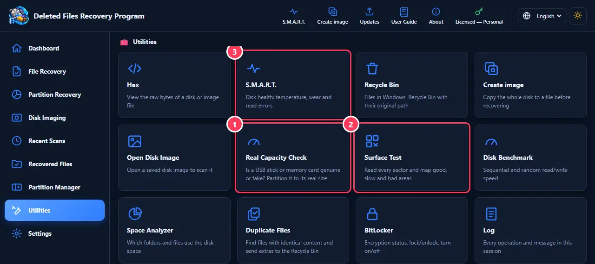

1. Real capacity check: is the USB stick genuine or fake?
2. Surface test: finds damaged or slow areas.
3. S.M.A.R.T: the disk's health, temperature and wear.

[↑ Back to contents](#contents)

---

## 10. Real capacity check (fake stick?)

Some USB sticks and memory cards are sold with a fake size: labelled 32GB but holding only 8 or 16. They work at first, then files get corrupted or formatting stops halfway. This check exposes them in minutes.

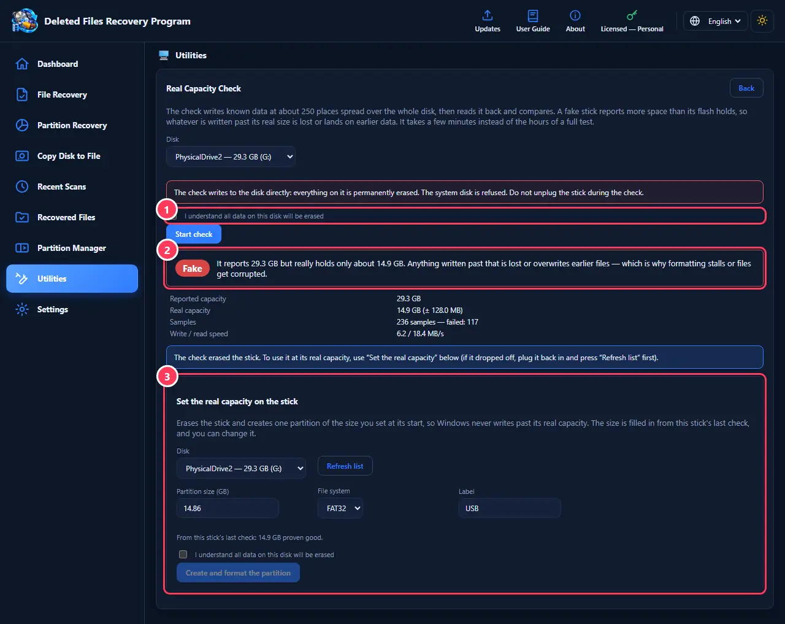

1. Pick the stick, tick “I understand all data will be erased” (copy your files off it first), then “Start check”.
2. The verdict: genuine, fake with its real size, partly damaged, or “stopped responding”.
3. “Set the real capacity on the stick”: the size is filled in from the check. Tick the box and press “Create and format the partition”, and the stick uses only its real capacity and works safely. If the stick dropped off during the check, plug it back in and press “Refresh list” first.

[↑ Back to contents](#contents)

---

## 11. Surface test

Reads the whole disk and draws a map: green good, yellow slow, red damaged. It changes nothing on the disk.

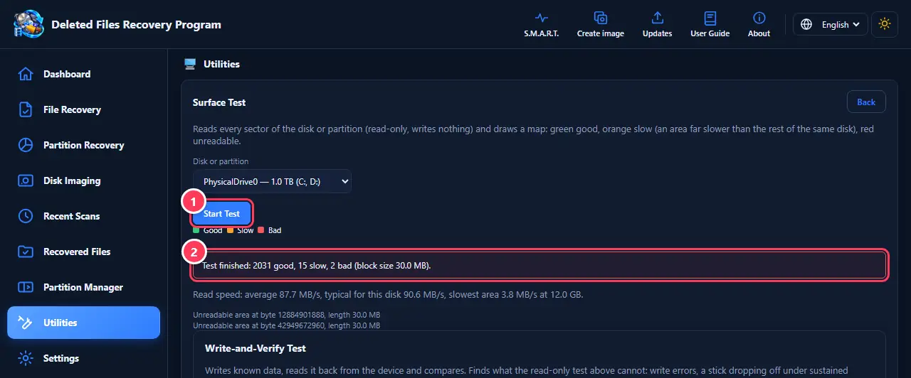

1. Pick the disk and press “Start test”.
2. The summary: how many areas are good, slow and damaged, and where.

> **Tips:**
> - If damaged areas show up, copy your important files off the disk right away. Below the test there is the more thorough “Write-and-Verify Test”.

[↑ Back to contents](#contents)

---

## 12. Disk health (S.M.A.R.T)

What the disk records about itself: whether it is healthy, its temperature, its wear (for SSDs) and its hours of use.

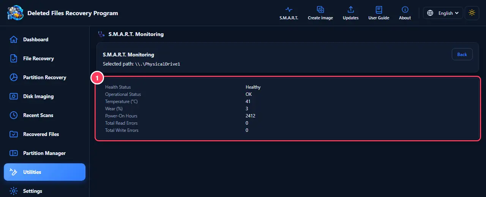

1. “Healthy” means fine. Watch out for a temperature always above 60°, wear close to 100%, or read errors.

[↑ Back to contents](#contents)

---

## 13. Disk speed test

Measures the real read and write speed of a disk or stick with a temporary file deleted afterwards, without touching your files.

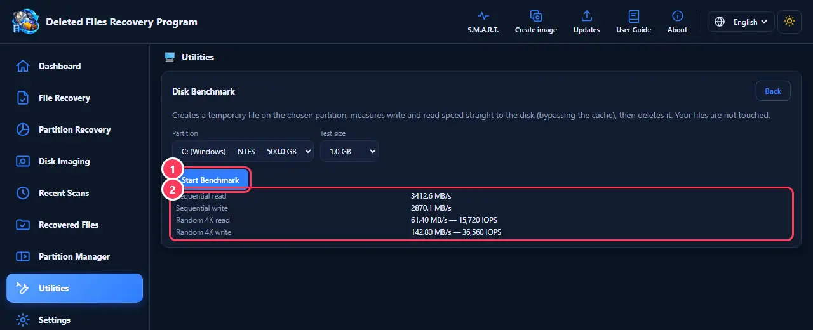

1. Pick the partition and the test size, then “Start”.
2. The results: sequential speed (copying big files) and random speed (running programs).

[↑ Back to contents](#contents)

---

## 14. Space analyzer

Shows which folders and files use up the disk, so you know what to delete or move when it is full.

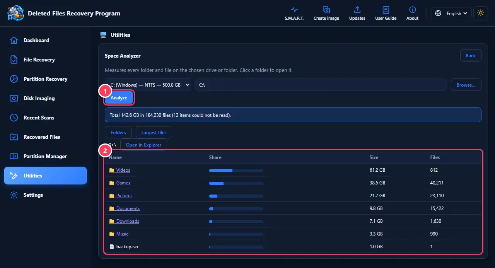

1. Pick the drive or folder and press “Analyze”.
2. Folders are listed largest first. Click one to open it.

[↑ Back to contents](#contents)

---

## 15. Duplicate files

Finds files with identical content even when their names differ, and frees space by moving the extra copies to the Recycle Bin.

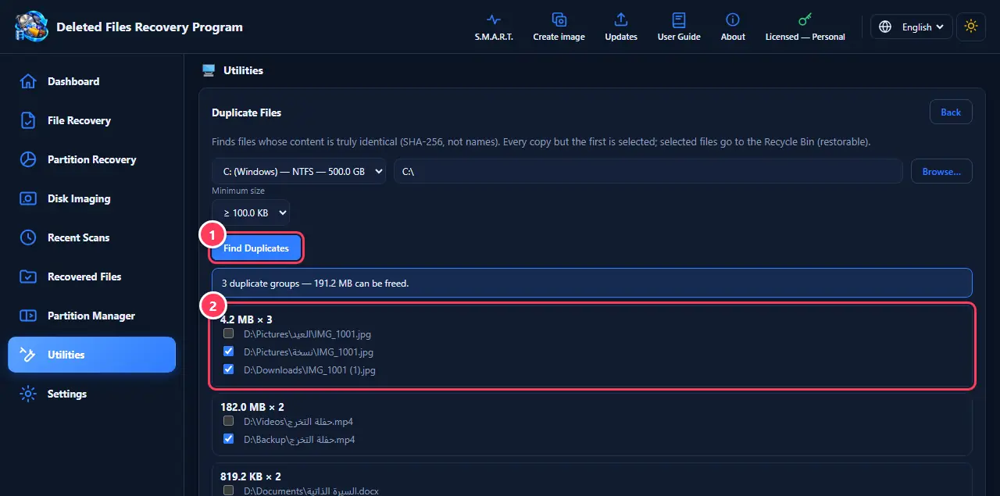

1. Pick the drive or folder and press “Find duplicates”.
2. In each group the extra copies are ticked automatically and one copy is kept; review them, then move them to the Recycle Bin.

> **Tips:**
> - Files go to the Recycle Bin, not deleted for good, so you can undo from Windows' Recycle Bin.

[↑ Back to contents](#contents)

---

## 16. BitLocker (disk encryption)

Shows whether a partition is encrypted with BitLocker, and lets you lock, unlock, turn encryption on or off.

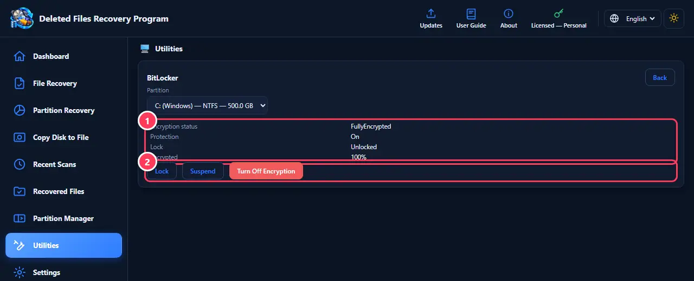

1. Encryption, protection and lock status, and how much is encrypted.
2. Buttons to lock, suspend, and turn encryption off.

> **Tips:**
> - Keep the Recovery Key somewhere safe before turning encryption on.

[↑ Back to contents](#contents)

---

## 17. Recycle Bin

Shows what is in Windows' Recycle Bin with each file's original path and deletion date, and gets any of them back.

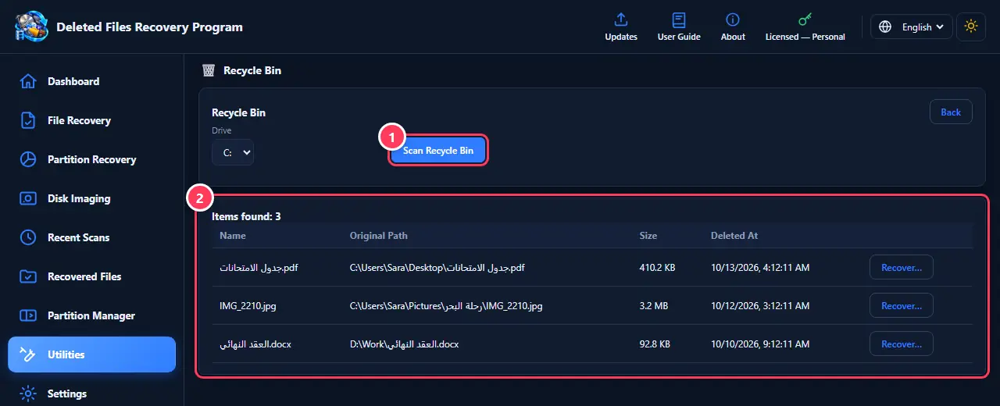

1. Pick the drive and press “Scan Recycle Bin”.
2. Press “Recover…” next to a file to save it.

[↑ Back to contents](#contents)

---

## 18. Settings and updates

The program's language and look, checking for updates, the version, and license management.

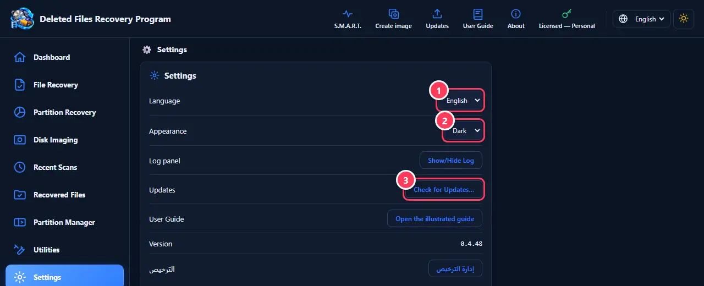

1. Language: Arabic or English; it stays as you chose after updates.
2. Look: light or dark.
3. “Check for updates”: tells you when a newer version is out and installs it.

> **Tips:**
> - When the program starts it tells you automatically if an update is available.
> - The License button (the key) in the top bar shows your edition; use it to activate the program, or to paste an upgrade key if you bought a higher edition.
> - If something goes wrong: “Create diagnostic report…” saves a text file with your disks and the program's recent errors (no file names), and “Report a problem” opens the page to send it with a description.

[↑ Back to contents](#contents)

---
