

# دليل استخدام برنامج استرجاع الملفات المحذوفة

[English](GUIDE.en.md) · [نسخة PDF للطباعة](GUIDE-ar.pdf) · [تنزيل البرنامج](README.md)

شرح مبسّط بالصور لكل قسم في البرنامج. الأرقام الحمراء في كل صورة تطابق الخطوات المكتوبة تحتها. الدليل نفسه موجود داخل البرنامج من زر «دليل الاستخدام» في الأعلى.

## المحتويات

1. [البداية: الواجهة الرئيسية](#start)
2. [فتح ملف صورة قرص](#openimage)
3. [استعادة الملفات: أنواع الفحص](#scan)
4. [النتائج واسترجاع الملفات](#results)
5. [استعادة الأقسام المفقودة](#lost)
6. [نسخ القرص إلى ملف (صورة)](#imaging)
7. [عمليات الفحص السابقة](#recent)
8. [إدارة الأقسام](#partitions)
9. [نسخ قرص إلى قرص](#clone)
10. [الأدوات الإضافية](#tools)
11. [فحص السعة الحقيقية (فلاشة مقلدة؟)](#capacity)
12. [اختبار سطح القرص](#surface)
13. [صحة القرص S.M.A.R.T](#smart)
14. [قياس سرعة القرص](#benchmark)
15. [محلل المساحة](#space)
16. [الملفات المكررة](#dups)
17. [BitLocker (تشفير القرص)](#bitlocker)
18. [سلة المحذوفات](#recycle)
19. [عارض Hex](#hex)
20. [الإعدادات والتحديثات والترخيص](#settings)
21. [حل المشاكل والتقارير](#troubleshoot)

## 1. البداية: الواجهة الرئيسية

من هنا تبدأ أي عملية استعادة. تعرض الشاشة كل الأقراص المتصلة بالجهاز (الداخلية والفلاشات وبطاقات الذاكرة) وأقسام كل قرص بحرفها وحجمها ونظام ملفاتها والمساحة الحرة فيها، ومعها حالة القرص (سليم أو لا) ونوعه (NVMe أو SSD أو USB). الطريق المعتاد: تختار القرص الذي حُذفت منه الملفات، ثم نوع الفحص، ثم تضغط «بدء الفحص».

1. اختر من «الأقراص المكتشفة» ما كانت عليه الملفات: سطر «القرص كاملًا» يفحص كل مساحة القرص (ومنها الأقسام المحذوفة)، وسطر القسم (مثل D:) يفحص ذلك القسم فقط وهو أسرع.
2. اختر نوع الفحص: «فحص سريع» للملفات المحذوفة حديثًا من قسم سليم، أو «فحص عميق» بعد الفورمات أو التلف، أو «البحث عن الأقسام المفقودة» إذا اختفى قسم كامل.
3. اضغط «بدء الفحص»، فتنتقل إلى شاشة الفحص المناسبة.
4. مخطط الأقسام يرسم أقسام القرص المختار بنسبة أحجامها؛ اضغط على قسم في المخطط لاختياره مباشرة.
5. أزرار مختصرة لنفس العمليات: فحص سريع، فحص عميق، البحث عن الأقسام المفقودة، واستعراض ملف صورة قرص محفوظ سابقًا.

> **نصائح:**
> - أهم قاعدة: لا تحفظ أي شيء جديد على القرص الذي حُذفت منه الملفات حتى تنتهي — لا تنزيلات ولا برامج ولا حتى الملفات المستعادة. كل كتابة جديدة قد تأخذ مكان ملف محذوف فيضيع نهائيًا.
> - إذا لم يظهر قرص أو فلاشة ركّبتها الآن، اضغط «تحديث». يظهر القرص هنا مرة واحدة وتحته أقسامه.
> - شارة «قرص النظام» تعني القرص الذي يعمل منه ويندوز، و«قسم ويندوز» هو C:. يمكنك فحصهما والاسترجاع منهما، لكن احفظ الملفات المستعادة على قرص آخر.
> - القرص الذي حالته «غير سليم» أو يصدر أصواتًا: انسخه أولًا إلى ملف (انظر «نسخ القرص إلى ملف») ثم افحص النسخة.

[↑ العودة إلى المحتويات](#contents)

---

## 2. فتح ملف صورة قرص

ملف صورة القرص (Image) نسخة كاملة من قرص محفوظة في ملف واحد — صنعته بالبرنامج من «نسخ القرص إلى ملف»، أو بأداة أخرى (ملفات .img و .dd و .bin الخام). تفتحه هنا وتفحصه وتسترجع منه تمامًا كأنه القرص نفسه، دون أن تلمس القرص الأصلي.

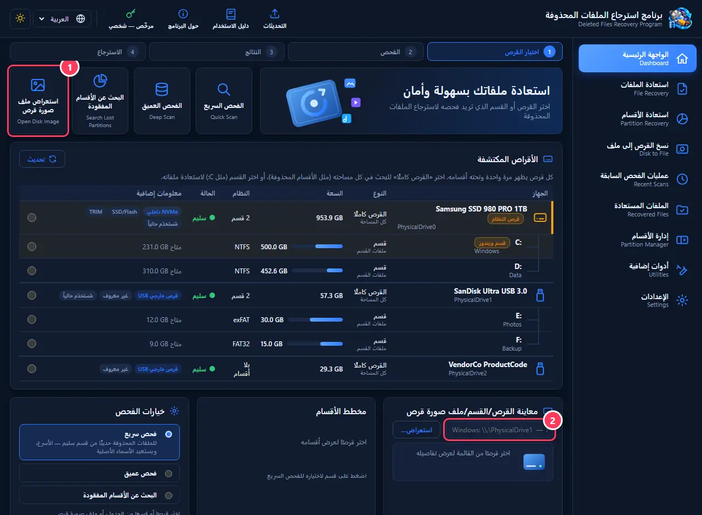

1. اضغط «استعراض ملف صورة قرص» واختر ملف النسخة.
2. يظهر مسار الملف في خانة المعاينة. بعدها اختر نوع الفحص واضغط «بدء الفحص» كالمعتاد.

> **نصائح:**
> - يمكنك أيضًا كتابة مسار ملف أو قرص يدويًا في نفس الخانة (مثل \\.\PhysicalDrive1).
> - الفحص من ملف صورة أسرع وأأمن من الفحص المتكرر لقرص ضعيف.

[↑ العودة إلى المحتويات](#contents)

---

## 3. استعادة الملفات: أنواع الفحص

بعد اختيار القرص تظهر شاشة الفحص. كل طريقة تناسب حالة مختلفة، واختيار الصحيحة يوفّر عليك وقتًا كثيرًا:

1. الفحص السريع: يقرأ سجلات نظام الملفات (NTFS أو FAT32 أو exFAT أو ext4 أو HFS+) فيعيد الملفات بأسمائها الأصلية ومجلداتها وتواريخها. يستغرق ثواني إلى دقائق. مناسب إذا حذفت الملفات حديثًا ولم تُهيّئ القرص.
2. نسخ القرص إلى ملف أولًا: إذا كان القرص ضعيفًا أو يصدر أصواتًا أو بطيئًا جدًا أو ينفصل وحده — انسخه كله إلى ملف على قرص سليم، ثم افحص النسخة بدل القرص المتعب.
3. استرجاع قسم محذوف: إذا اختفى قسم كامل (مثلًا اختفى القرص D:، أو ظهر القرص «غير مخصص» أو «RAW»).

1. الفحص العميق: يقرأ القرص كله قطاعًا بقطاع ويتعرّف على الملفات من «بصمتها» (بداية كل نوع: صور JPG وPNG، مستندات PDF وWord وExcel، فيديو MP4، أرشيفات ZIP…). يجد الملفات حتى بعد الفورمات أو تلف نظام الملفات، لكنه أبطأ (قد يستغرق ساعات لقرص كبير) ولا يعرف أسماء الملفات الأصلية فيسمّيها بأرقام.
2. اضغط «ابدأ الفحص العميق». خيار «تخطّي المناطق التالفة والبطيئة» مهم للفلاشات والأقراص المتضررة: يتجاوز الأماكن التي لا تُقرأ بدل أن يعلق عندها.

1. شريط التقدم: النسبة، وكم قُرئ من الحجم الكلي، والوقت المتبقي تقريبًا.
2. «إلغاء الفحص» يوقفه ويعرض ما وُجد حتى الآن. يحفظ الفحص العميق موضعه أولًا بأول، فإذا أُغلق البرنامج أو انقطعت الكهرباء يعرض عليك المتابعة من حيث توقف.

> **نصائح:**
> - ابدأ دائمًا بالفحص السريع؛ إذا لم تجد ملفاتك (أو وجدتها بلا أسماء) جرّب الفحص العميق.
> - اختيار «القرص كاملًا» في الفحص العميق يبحث في كل مكان، حتى في المساحات التي كانت فيها أقسام محذوفة.
> - لا تستخدم الجهاز في أعمال ثقيلة أثناء الفحص العميق؛ اتركه يعمل ولا تطفئه.

[↑ العودة إلى المحتويات](#contents)

---

## 4. النتائج واسترجاع الملفات

بعد الفحص تظهر كل الملفات التي عُثر عليها مع اسمها وحجمها ونوعها وحالتها. ابحث عن ملفاتك، عاينها للتأكد أنها سليمة، ثم استرجعها — ملفًا واحدًا أو مجموعة دفعة واحدة — إلى قرص آخر.

1. تصنيفات جاهزة: الكل، صور، مستندات، فيديو، صوت، أرشيفات — اضغط تصنيفًا لعرضه فقط. «معاينة الصور» تعرض الصور كمصغّرات لتجد صورتك بالنظر.
2. «توليد معاينة» يعرض محتوى الملف المختار (صورة أو نص أو معلومات الملف) قبل استرجاعه.
3. «استرجاع» يحفظ الملف المختار، أو كل الملفات التي وضعت عليها علامة ✓.
4. «شاشة التقرير النهائي» لتصدير قائمة الملفات المكتشفة.

1. ابحث باسم الملف أو امتداده (مثل jpg أو pdf)، ورشّح حسب النوع وحالة الملف. يمكنك ترتيب الجدول بالضغط على عناوين الأعمدة.
2. ضع علامة ✓ بجانب كل ملف تريده لاسترجاع عدة ملفات مرة واحدة.
3. شجرة النتائج: «سليم» يعني أن الملف كامل غالبًا، و«جزئي» أن جزءًا منه قد يكون تالفًا أو كُتب فوقه، و«غير مقروء» أن مكانه على القرص لم يُقرأ.

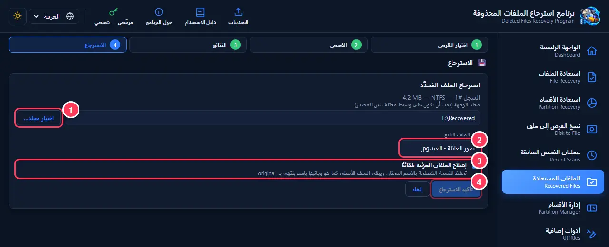

1. «اختيار مجلد…»: مكان الحفظ، ويجب أن يكون على قرص آخر غير الذي تستعيد منه — ينبّهك البرنامج إذا اخترت نفس القرص.
2. اسم الملف الناتج: يمكنك تغييره قبل الحفظ.
3. «إصلاح الملفات الجزئية تلقائيًا»: يحاول إصلاح الملف إذا كان جزئيًا، ويحتفظ بالنسخة الأصلية بجانبه باسم ينتهي بـ _original.
4. «تأكيد الاسترجاع» يحفظ الملف في المجلد الذي اخترته.

1. عند تحديد عدة ملفات: اختر مجلدًا للحفظ على قرص آخر.
2. اضغط «بدء الاسترجاع الجماعي». يظهر شريط تقدم، ويحاول البرنامج إصلاح الملفات الجزئية تلقائيًا، وفي النهاية ملخص بما نجح وما لم ينجح.

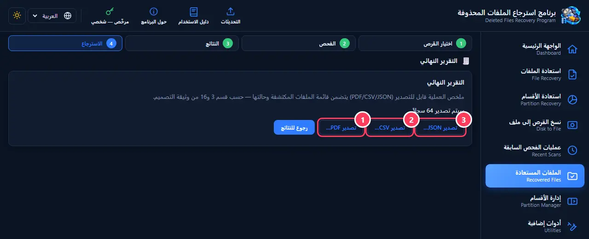

1. «تصدير PDF…»: تقرير مقروء جاهز للطباعة أو الإرسال.
2. «تصدير CSV…»: جدول يفتح في Excel لترتيب الملفات وتصفيتها.
3. «تصدير JSON…»: للبرامج والأدوات الأخرى.

> **نصائح:**
> - احفظ الملفات المستعادة دائمًا على قرص مختلف — فلاشة أو قرص خارجي أو قرص آخر داخل الجهاز.
> - إذا كانت النتائج كثيرة جدًا، ابدأ بتصنيف (مثل «صور») ثم ابحث بالامتداد.
> - الملف «الجزئي» قد يفتح ناقصًا (صورة نصفها رمادي مثلًا)؛ هذا يعني أن جزءًا منه كُتب فوقه بعد الحذف.
> - تُحفظ نتائج آخر فحص تلقائيًا؛ تعود إليها من «عمليات الفحص السابقة» حتى بعد إغلاق البرنامج.

[↑ العودة إلى المحتويات](#contents)

---

## 5. استعادة الأقسام المفقودة

عندما يختفي قسم كامل — حُذف بالخطأ من إدارة الأقراص، أو ظهر القرص «غير مخصص» أو «RAW» ويطلب ويندوز تهيئته، أو تلف جدول الأقسام بعد انقطاع كهرباء أو فيروس، أو أُعيد تقسيم القرص — تبقى البيانات غالبًا موجودة، لكن ويندوز لا يعرف مكانها. هذه الشاشة تقرأ القرص كله وتبحث عن بدايات الأقسام (NTFS وFAT32 وexFAT وext4 وHFS+) ثم تتيح لك إعادتها.

1. اضغط «ابدأ البحث» — يقرأ البرنامج القرص كله ولا يكتب عليه شيئًا. يستغرق ذلك بحسب حجم القرص وسرعته.
2. تظهر الأقسام التي عُثر عليها بنوعها وموقعها وحجمها. «فحص هذا القسم» يفتح فحص الملفات داخله فتسترجعها إلى قرص آخر — الطريق الأأمن.
3. «استعادة القسم» يعيده إلى مكانه في جدول الأقسام فيظهر في ويندوز بحرفه وملفاته كما كان.

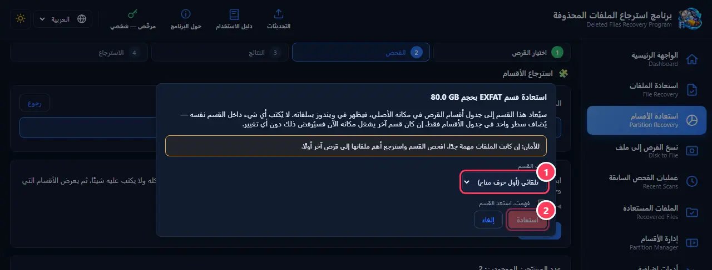

1. اختر حرف القسم من القائمة، أو اتركه «تلقائي» ليختار ويندوز أول حرف متاح.
2. ضع علامة «فهمت، استعد القسم» ثم اضغط «استعادة». يُضاف سطر واحد في جدول الأقسام فقط، ولا يُكتب أي شيء داخل القسم نفسه. إن كان قسم آخر يشغل مكانه الآن فسيُرفض ذلك دون أي تغيير.

> **نصائح:**
> - إذا كانت الملفات مهمة جدًا: افحص القسم واسترجع أهم ملفاتها إلى قرص آخر أولًا، ثم استعد القسم.
> - القسم الذي ما زال موجودًا يظهر بعبارة «موجود حاليًا» ولا يحتاج استعادة.
> - «خيارات متقدمة» فيها دقة البحث: اتركها 1 ميجابايت، وصغّرها (مثل 512) فقط لقرص قديم جدًا أو إذا لم يجد البحث شيئًا — يصبح البحث أبطأ بكثير.
> - إذا طلب ويندوز «تهيئة» القرص عند توصيله، اضغط «إلغاء» — التهيئة قد تمسح فرصة الاستعادة.
> - أقسام ext4 وHFS+ (لينكس وماك) لا يقرؤها ويندوز، فتُفحص ملفاتها وتُسترجع فقط.

[↑ العودة إلى المحتويات](#contents)

---

## 6. نسخ القرص إلى ملف (صورة)

ينسخ القرص كله، قطاعًا بقطاع، إلى ملف واحد على قرص سليم. القرص الضعيف قد يسوء مع كل قراءة؛ هنا يُقرأ مرة واحدة فقط، ثم تفحص الملف وتسترجع منه مرات كثيرة براحتك. القطاعات التالفة لا توقف النسخ: يتجاوزها البرنامج ويسجّل أماكنها.

1. «اختيار ملف…»: مكان ملف النسخة على قرص آخر فيه مساحة تكفي حجم القرص المنسوخ كله.
2. اضغط «ابدأ النسخ» وانتظر حتى ينتهي. بعدها اضغط «فحص النسخة الآن» لتفحص الملف مباشرة.

> **نصائح:**
> - لفتح نسخة محفوظة لاحقًا: الواجهة الرئيسية ← «استعراض ملف صورة قرص».
> - الفرق عن «نسخ قرص إلى قرص»: هنا الناتج ملف تفحصه وتسترجع منه داخل البرنامج ولا يُمسح أي قرص؛ أما «نسخ قرص إلى قرص» فيكتب نسخة جاهزة على قرص آخر (ويمسح ما عليه) لتستخدمها مباشرة في ويندوز.
> - حجم الملف يساوي حجم القرص كله حتى لو كان القرص شبه فارغ.

[↑ العودة إلى المحتويات](#contents)

---

## 7. عمليات الفحص السابقة

يحفظ البرنامج نتائج آخر فحص تلقائيًا، فتعود إليها دون إعادة الفحص — حتى بعد إغلاق البرنامج أو إعادة تشغيل الجهاز. مفيد جدًا بعد فحص عميق استغرق ساعات.

1. يظهر القرص الذي فُحص وعدد الملفات التي وُجدت. «عرض النتائج» يعيدك إلى قائمة الملفات، و«تجاهل» يحذف هذه النتائج المحفوظة (ولا يمس القرص).

> **نصائح:**
> - عند تشغيل البرنامج بعد فحص لم يكتمل، يعرض عليك متابعته من حيث توقف.

[↑ العودة إلى المحتويات](#contents)

---

## 8. إدارة الأقسام

لتنظيم الأقراص: تقسيم قسم إلى قسمين، تصغير قسم أو تكبيره، نقله، دمج قسمين، إنشاء قسم جديد من المساحة الفارغة، تهيئته وتغيير اسمه وحرفه، وغيرها. كل العمليات تمر بخدمة التخزين في ويندوز نفسها، ويعرض البرنامج شكل القرص بعد العملية قبل تنفيذها. على قرص ويندوز (قرص النظام) يُتاح فقط ما يسمح به ويندوز وهو يعمل.

1. «إدارة الأقسام»: تعديل أقسام أي قرص.
2. «نسخ قرص إلى قرص»: نقل قرص كامل إلى قرص آخر.
3. «نسخ القرص إلى ملف»: نسخ قرص كامل إلى ملف واحد (صورة) قبل الاسترجاع.

1. اختر القرص من القائمة، ثم اضغط على قسم أو على مساحة «فارغ» في الخريطة أو الجدول لاختيارها.
2. بطاقات العمليات الرئيسية للقسم المختار: تقسيم إلى قسمين، تصغير، تكبير، نقل. البطاقة الباهتة غير متاحة الآن، ومكتوب تحتها السبب.
3. أزرار سريعة: تهيئة، تغيير الاسم، تغيير الحرف، فتح القسم في المستكشف، و«المزيد»، وحذف القسم.

1. حرّك المؤشر أو اكتب الحجم بالجيجابايت (أو اضغط «ربع» أو «نصف»). يمكنك أيضًا اختيار نظام ملفات القسم الجديد واسمه.
2. الشريط الملون يريك شكل القرص بعد العملية، وتحته «النتيجة» بالأحجام الدقيقة — قبل أن يتغير أي شيء.
3. اضغط «تنفيذ». يظهر شريط تقدم؛ لا تطفئ الجهاز ولا تفصل القرص أثناء العملية.

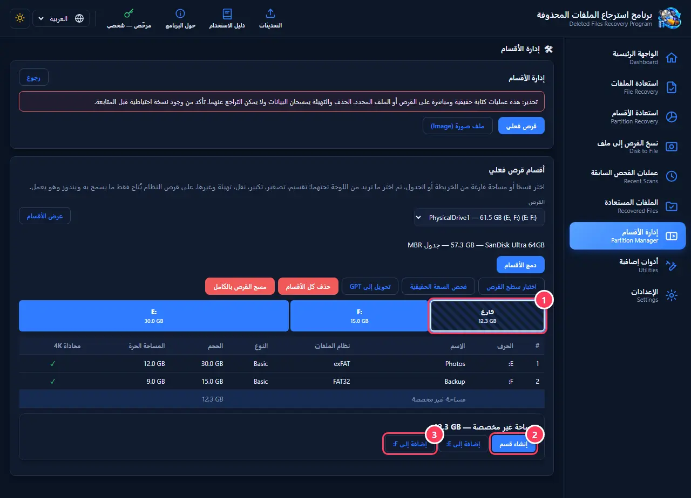

1. اضغط على مساحة «فارغ» (غير مخصصة) في الخريطة.
2. «إنشاء قسم»: قسم جديد في هذه المساحة — حتى على قرص ويندوز.
3. «إضافة إلى X:»: تضم المساحة إلى قسم موجود. يعمل حتى لو كان بينهما قسم آخر (مثل قسم الاسترداد): يُنقل تلقائيًا ويُعرض لك ما سيحدث قبل التنفيذ.

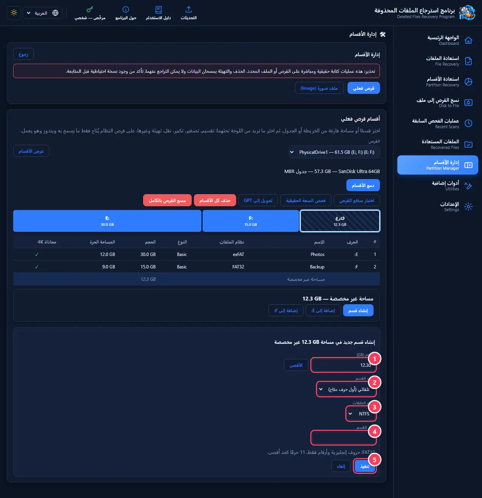

1. الحجم بالجيجابايت؛ «الأقصى» يأخذ المساحة كلها.
2. حرف القسم: اختر أي حرف متاح، أو «تلقائي».
3. نظام الملفات: NTFS للأقراص الداخلية والخارجية الكبيرة، exFAT للفلاشات التي تُستخدم مع أجهزة أخرى وملفات أكبر من 4GB، FAT32 للأجهزة القديمة.
4. اسم القسم (اختياري) كما يظهر في «هذا الكمبيوتر».
5. «تنفيذ»: يُنشأ القسم ويُهيّأ ويظهر بحرفه فورًا.

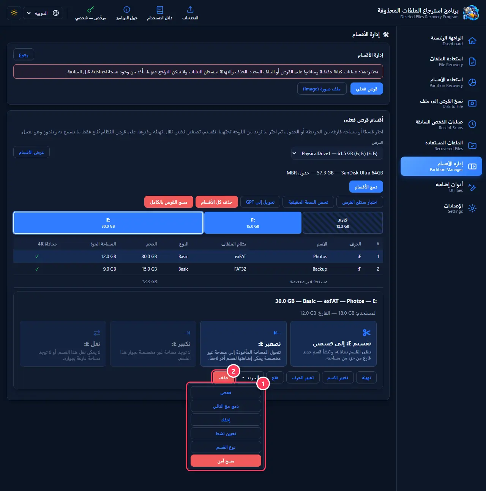

1. قائمة «المزيد» فيها العمليات الأقل استخدامًا: فحص نظام الملفات وإصلاحه، دمج القسم مع التالي، إخفاء القسم أو إظهاره، تعيينه نشطًا (لأقراص MBR القديمة)، تغيير نوع القسم، والمسح الآمن الذي يكتب فوق القسم كله فلا تُستعاد ملفاته أبدًا.
2. «حذف»: يحذف القسم بعد تأكيدك. يمكن غالبًا استعادته لاحقًا من «استعادة الأقسام» ما لم تُكتب فوقه بيانات جديدة.

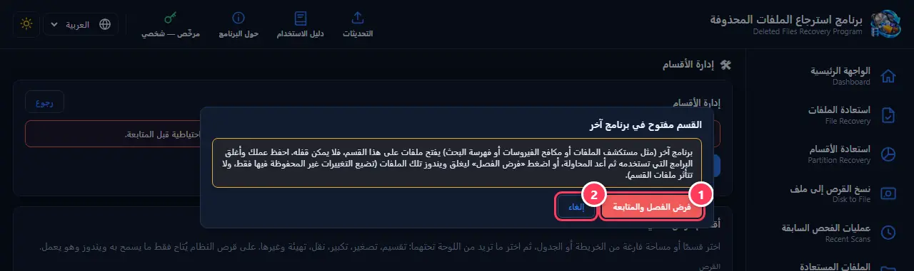

1. تظهر هذه النافذة إذا كان برنامج آخر (مثل المستكشف أو مكافح الفيروسات أو فهرسة البحث) يفتح ملفات على القسم أثناء نقله أو تكبيره. احفظ عملك وأغلق تلك البرامج ثم أعد المحاولة، أو اضغط «فرض الفصل والمتابعة» فيغلق ويندوز تلك الملفات وتكمل العملية — لا تضيع إلا التغييرات غير المحفوظة فيها، ولا تتأثر ملفات القسم.
2. «إلغاء» يوقف العملية دون أي تغيير.

> **نصائح:**
> - خذ نسخة احتياطية من ملفاتك المهمة قبل نقل قسم أو تغيير حجمه، ولا تطفئ الجهاز أثناء العملية.
> - أزرار القرص كله فوق الخريطة: «دمج الأقسام»، «اختبار سطح القرص»، «فحص السعة الحقيقية»، «تحويل إلى GPT/MBR»، «حذف كل الأقسام»، و«مسح القرص بالكامل». الأخيرة تمسح كل شيء نهائيًا.
> - إذا سمح ويندوز بتصغير قسم أقل من مساحته الفارغة، يشرح البرنامج السبب (ملف في نهاية القسم لا يتحرك، مثل ملف الذاكرة الافتراضية) ويعرض حلًا عندما يكون ممكنًا.
> - أول مرة تفتح فيها الشاشة قد تظهر عبارة «يجري تحديث معلومات القرص…» لثانية؛ تعمل الأزرار بعدها مباشرة.
> - إذا ظهرت رسالة «القسم مفتوح في برنامج آخر» فأغلق البرامج التي تستخدم القسم ثم أعد المحاولة، أو اضغط «فرض الفصل والمتابعة» بعد حفظ عملك.
> - عمود «محاذاة 4K» يجب أن يكون ✓؛ القسم غير المحاذي أبطأ على أقراص SSD الحديثة.

[↑ العودة إلى المحتويات](#contents)

---

## 9. نسخ قرص إلى قرص

ينسخ قرص بيانات كاملًا (كل الأقسام والملفات) على قرص آخر مباشرة، قطاعًا بقطاع، فيصبح القرص الثاني نسخة طبق الأصل جاهزة للعمل فورًا. يعطي النسخة معرّفات جديدة حتى يعمل القرصان معًا في نفس الجهاز. مفيد للانتقال إلى قرص أكبر، أو لاستبدال قرص بدأ يضعف، أو لعمل نسخة احتياطية جاهزة.

1. القرص المصدر: الذي تريد نسخه.
2. القرص الهدف: سيُمحى كل ما عليه ويصبح نسخة من المصدر، ويجب ألا يكون أصغر منه. ضع علامة الموافقة ثم «ابدأ النسخ».

> **نصائح:**
> - تأكد مرتين من اختيار القرص الهدف الصحيح — محتواه يُمحى نهائيًا. افحص الاسم والحجم، لا الحرف فقط.
> - قرص ويندوز لا يمكن أن يكون مصدرًا ولا هدفًا هنا.
> - إذا كان الهدف أكبر من المصدر، تبقى بقيته مساحة فارغة تضمها لاحقًا من «إدارة الأقسام».
> - تريد فقط حفظ القرص في ملف لتفحصه وتسترجع منه؟ استخدم «نسخ القرص إلى ملف».

[↑ العودة إلى المحتويات](#contents)

---

## 10. الأدوات الإضافية

أدوات لفحص صحة الأقراص والفلاشات وسرعتها وتنظيم مساحتها: فحص السعة الحقيقية، اختبار السطح، S.M.A.R.T، قياس السرعة، محلل المساحة، الملفات المكررة، BitLocker، سلة المحذوفات، وعارض Hex. لكل أداة قسم خاص بها في هذا الدليل.

1. فحص السعة الحقيقية: هل الفلاشة أو بطاقة الذاكرة أصلية أم مقلّدة؟
2. اختبار سطح القرص: يبحث عن الأماكن التالفة أو البطيئة.
3. S.M.A.R.T: صحة القرص وحرارته ونسبة تآكله.

> **نصائح:**
> - الأدوات التي تقرأ فقط (اختبار السطح، S.M.A.R.T، محلل المساحة، Hex) لا تغيّر شيئًا على القرص. الأدوات التي تكتب (فحص السعة، اختبار الكتابة) تطلب موافقتك أولًا وتنبهك أنها تمسح البيانات.

[↑ العودة إلى المحتويات](#contents)

---

## 11. فحص السعة الحقيقية (فلاشة مقلدة؟)

بعض الفلاشات وبطاقات الذاكرة تُباع بسعة غير حقيقية: مكتوب عليها 32GB وفيها 8 أو 16 فقط. تعمل في البداية، ثم تتلف الملفات أو تتوقف التهيئة في منتصفها. هذا الفحص يكتب بيانات اختبار في أنحاء الفلاشة ثم يقرؤها ليكشف سعتها الحقيقية في دقائق، ثم يصلحها لتعمل بأمان بسعتها الحقيقية.

1. اختر الفلاشة، وضع علامة على «أفهم أن كل البيانات ستُمحى» (انسخ ملفاتك منها أولًا)، ثم «ابدأ الفحص».
2. النتيجة: أصلية، أو مقلّدة مع سعتها الحقيقية، أو تالفة جزئيًا، أو «توقفت عن الاستجابة».
3. «تثبيت السعة الحقيقية على الفلاشة»: يُملأ الحجم تلقائيًا من نتيجة الفحص. ضع العلامة واضغط «إنشاء القسم وتهيئته» فتستخدم الفلاشة سعتها الحقيقية فقط وتعمل بأمان. إذا انفصلت الفلاشة أثناء الفحص، أعد توصيلها واضغط «تحديث القائمة» أولًا.

> **نصائح:**
> - الفلاشة المقلّدة التي ثُبّتت سعتها الحقيقية آمنة للاستخدام، لكن لا تثق بها لملفات مهمة دون نسخة أخرى.

[↑ العودة إلى المحتويات](#contents)

---

## 12. اختبار سطح القرص

يقرأ القرص كله ويرسم خريطة: أخضر سليم، أصفر بطيء، أحمر تالف. القراءة البطيئة جدًا علامة مبكرة على قرص بدأ يضعف. لا يغيّر أي شيء على القرص.

1. اختر القرص واضغط «ابدأ الاختبار». يمكنك إيقافه في أي وقت.
2. الملخص: عدد المناطق السليمة والبطيئة والتالفة، وأماكن التالفة على القرص.

> **نصائح:**
> - إذا ظهرت مناطق تالفة، انسخ ملفاتك المهمة من القرص فورًا، ثم انسخ القرص إلى ملف قبل أي محاولة استعادة.
> - تحت الاختبار يوجد «اختبار الكتابة والتحقق» الأدق: يكتب على القرص كله ثم يقرأ ويتحقق — يمسح كل البيانات، فاستخدمه فقط لقرص فارغ أو جديد.

[↑ العودة إلى المحتويات](#contents)

---

## 13. صحة القرص S.M.A.R.T

معلومات يسجلها القرص عن نفسه طوال عمره: هل هو سليم، حرارته، نسبة تآكله (لأقراص SSD)، عدد ساعات تشغيله، وأخطاء القراءة والكتابة. نظرة سريعة تخبرك هل القرص يحتاج استبدالًا قريبًا.

1. «Healthy» تعني سليم. انتبه إذا كانت الحرارة فوق 60° باستمرار، أو التآكل قريبًا من 100%، أو ظهرت أخطاء قراءة أو كتابة — هذه علامات لنسخ ملفاتك احتياطيًا.

> **نصائح:**
> - بعض الفلاشات وقارئات البطاقات لا ترسل معلومات S.M.A.R.T، فتظهر «غير متاح» — هذا طبيعي.

[↑ العودة إلى المحتويات](#contents)

---

## 14. قياس سرعة القرص

يقيس سرعة القراءة والكتابة الحقيقية للقرص أو الفلاشة بملف مؤقت يُحذف بعدها، دون المساس بملفاتك. مفيد لمعرفة هل الفلاشة بالسرعة المكتوبة عليها، أو هل القرص أصبح أبطأ من المعتاد.

1. اختر القسم وحجم الاختبار، ثم «ابدأ القياس».
2. النتائج: السرعة المتتابعة (تهمّ عند نسخ ملفات كبيرة كالأفلام) والعشوائية (تهمّ لتشغيل البرامج وويندوز).

> **نصائح:**
> - أغلق البرامج الأخرى أثناء القياس للحصول على نتيجة دقيقة.

[↑ العودة إلى المحتويات](#contents)

---

## 15. محلل المساحة

يعرض أي المجلدات والملفات تستهلك مساحة القرص، مرتبة من الأكبر، لتعرف ماذا تحذف أو تنقل عندما يمتلئ القرص.

1. اختر القرص أو المجلد واضغط «ابدأ التحليل».
2. المجلدات مرتبة من الأكبر مع نسبة كل منها. اضغط على مجلد للدخول إليه، و«أكبر الملفات» لقائمة أضخم الملفات في القرص كله.

> **نصائح:**
> - المحلل يقرأ فقط ولا يحذف شيئًا؛ احذف ما تريد بنفسك من المستكشف.

[↑ العودة إلى المحتويات](#contents)

---

## 16. الملفات المكررة

يجد الملفات المتطابقة في المحتوى حتى لو اختلفت أسماؤها أو أماكنها، ويوفّر المساحة بنقل النسخ الزائدة إلى سلة المحذوفات.

1. اختر القرص أو المجلد واضغط «ابحث عن المكررات».
2. في كل مجموعة تُحدَّد النسخ الزائدة تلقائيًا وتبقى نسخة واحدة؛ راجعها (يمكنك تغيير النسخة التي تبقى) ثم انقلها إلى سلة المحذوفات.

> **نصائح:**
> - النقل إلى سلة المحذوفات وليس حذفًا نهائيًا، فيمكنك التراجع من سلة ويندوز.

[↑ العودة إلى المحتويات](#contents)

---

## 17. BitLocker (تشفير القرص)

يعرض هل القسم مشفّر بـ BitLocker وحالته، ويتيح قفله وفتحه، وإيقاف الحماية مؤقتًا، وتفعيل التشفير أو إلغاءه. القسم المشفّر المقفول لا يُفحص ولا يُسترجع منه قبل فتحه.

1. حالة التشفير والحماية والقفل ونسبة التشفير لكل قسم.
2. أزرار القفل والفتح، والإيقاف المؤقت، وإلغاء التشفير.

> **نصائح:**
> - احتفظ بمفتاح الاسترداد (Recovery Key) في مكان آمن قبل تفعيل التشفير — بدونه لا يمكن فتح القسم إذا نسيت كلمة المرور.

[↑ العودة إلى المحتويات](#contents)

---

## 18. سلة المحذوفات

يعرض محتوى سلة محذوفات ويندوز لكل قرص مع المسار الأصلي لكل ملف وتاريخ حذفه، ويعيد أي ملف منها — حتى لو كانت السلة لا تظهر في سطح المكتب.

1. اختر القرص واضغط «فحص سلة المحذوفات».
2. اضغط «استرجاع…» بجانب الملف واختر مكان حفظه.

> **نصائح:**
> - إذا أفرغت السلة، فالملفات لم تعد هنا — استخدم الفحص السريع للقرص لاستعادتها.

[↑ العودة إلى المحتويات](#contents)

---

## 19. عارض Hex

أداة للمتقدمين: تعرض البايتات الخام للقرص أو ملف الصورة كما هي، بالأرقام الست عشرية وبجانبها النص. تفيد للتحقق من بداية قسم أو من محتوى منطقة معينة. لا تكتب شيئًا.

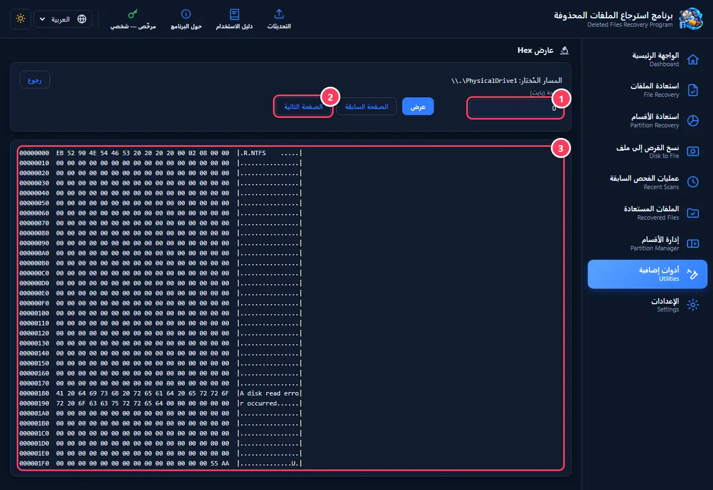

1. اكتب الإزاحة (الموقع بالبايت) واضغط «عرض».
2. «الصفحة السابقة» و«الصفحة التالية» للتنقل.
3. كل سطر: موقعه، ثم 16 بايتًا بالست عشري، ثم ما يقابلها من نص. في الصورة بداية قسم NTFS وتوقيعه 55 AA في نهاية القطاع.

> **نصائح:**
> - تفتحه من «أدوات إضافية» ← «Hex» بعد اختيار القرص في الواجهة الرئيسية.

[↑ العودة إلى المحتويات](#contents)

---

## 20. الإعدادات والتحديثات والترخيص

لغة البرنامج ومظهره، لوحة السجل، التحقق من التحديثات، دليل الاستخدام، تقرير التشخيص، رقم الإصدار، وإدارة الترخيص.

1. اللغة: العربية أو الإنجليزية، وتبقى كما اخترتها بعد التحديثات.
2. المظهر: فاتح أو داكن.
3. «التحقق من التحديثات»: يخبرك إذا صدر إصدار أحدث، وينزّله ويثبّته بعد التحقق من سلامة الملف.
4. تقرير التشخيص: «إنشاء تقرير تشخيص…» و«الإبلاغ عن مشكلة» — انظر قسم «حل المشاكل والتقارير».

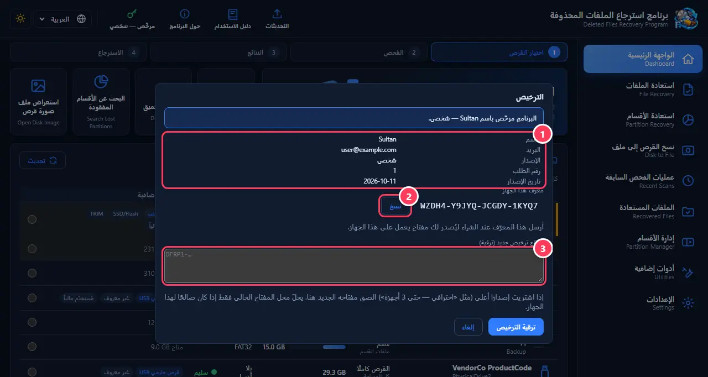

1. بيانات ترخيصك: الاسم والبريد والإصدار وتاريخه.
2. «نسخ» معرّف هذا الجهاز: أرسله عند الشراء ليُصدَر لك مفتاح يعمل على جهازك.
3. مفتاح ترخيص جديد: إذا اشتريت إصدارًا أعلى (مثل «احترافي» — حتى 3 أجهزة) الصق المفتاح هنا واضغط «ترقية الترخيص».

> **نصائح:**
> - عند تشغيل البرنامج يظهر تنبيه تلقائي إذا وُجد تحديث جديد.
> - نافذة الترخيص تفتح من زر «الترخيص» (رمز المفتاح) في الشريط العلوي أو من الإعدادات.
> - بعض الميزات (مثل الاسترجاع وعمليات الأقسام) تحتاج ترخيصًا؛ إذا لم يكن البرنامج مفعّلًا تظهر نافذة التفعيل عند استخدامها.

[↑ العودة إلى المحتويات](#contents)

---

## 21. حل المشاكل والتقارير

يسجّل البرنامج كل عملية تنفذها ونتيجتها، وكل خطأ بنصه الكامل، في سجل يبقى بعد إغلاقه. إذا واجهتك مشكلة، يساعدك السجل وتقرير التشخيص على معرفة السبب، ويساعدان المطوّر على إصلاحها في التحديث القادم.

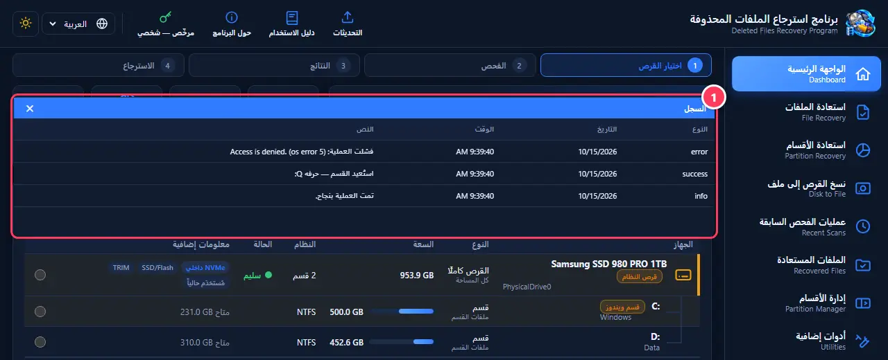

1. لوحة السجل: نوع كل حدث (معلومة، نجاح، خطأ) وتاريخه ووقته ونصه. تفتحها من الإعدادات ← «إظهار/إخفاء السجل».

> **نصائح:**
> - للإبلاغ عن مشكلة: الإعدادات ← «إنشاء تقرير تشخيص…» يحفظ ملفًا نصيًا فيه معلومات أقراصك ونظامك وآخر أخطاء البرنامج — بلا أسماء ملفاتك ولا محتواها. ثم «الإبلاغ عن مشكلة» يفتح صفحة البلاغ؛ أرفق التقرير مع وصف ما حدث.
> - لا يُرسل البرنامج أي شيء من جهازك تلقائيًا؛ أنت تراجع التقرير وتقرر إرساله.
> - رسالة «القسم مفتوح في برنامج آخر»: أغلق البرامج التي تستخدم القسم، أو اختر «فرض الفصل والمتابعة».
> - قرص لا يظهر: افصله وأعد توصيله ثم اضغط «تحديث»، وجرّب منفذ USB آخر أو كيبلًا آخر.
> - الفحص يعلق عند نسبة معينة: القرص غالبًا تالف في ذلك المكان — فعّل «تخطّي المناطق التالفة» أو انسخ القرص إلى ملف أولًا.

[↑ العودة إلى المحتويات](#contents)

---

