

# دليل استخدام برنامج استرجاع الملفات المحذوفة

[English](GUIDE.en.md) · [نسخة PDF للطباعة](GUIDE-ar.pdf) · [تنزيل البرنامج](README.md)

شرح مبسّط بالصور لكل قسم في البرنامج. الأرقام الحمراء في كل صورة تطابق الخطوات المكتوبة تحتها. الدليل نفسه موجود داخل البرنامج من زر «دليل الاستخدام» في الأعلى.

## المحتويات

1. [البداية: الواجهة الرئيسية](#start)
2. [استعادة الملفات: أنواع الفحص](#scan)
3. [النتائج واسترجاع الملفات](#results)
4. [استعادة الأقسام المفقودة](#lost)
5. [نسخ القرص إلى ملف (Image)](#imaging)
6. [عمليات الفحص السابقة](#recent)
7. [إدارة الأقسام](#partitions)
8. [نسخ قرص إلى قرص](#clone)
9. [الأدوات الإضافية](#tools)
10. [فحص السعة الحقيقية (فلاشة مقلدة؟)](#capacity)
11. [اختبار سطح القرص](#surface)
12. [صحة القرص S.M.A.R.T](#smart)
13. [قياس سرعة القرص](#benchmark)
14. [محلل المساحة](#space)
15. [الملفات المكررة](#dups)
16. [BitLocker (تشفير القرص)](#bitlocker)
17. [سلة المحذوفات](#recycle)
18. [الإعدادات والتحديثات](#settings)

## 1. البداية: الواجهة الرئيسية

من هنا تبدأ أي عملية استعادة. تختار القرص أو الفلاشة التي حُذفت منها الملفات، ثم نوع الفحص، ثم تضغط «بدء الفحص».

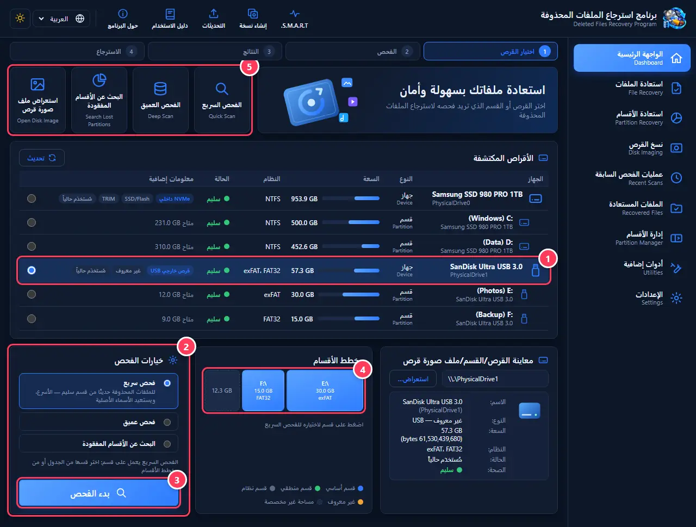

1. اختر من قائمة «الأقراص المكتشفة» القرص أو القسم الذي كانت عليه الملفات (مثل الفلاشة أو القرص D:).
2. اختر نوع الفحص: «فحص سريع» للملفات المحذوفة حديثًا، أو «فحص عميق» بعد الفورمات أو التلف، أو «البحث عن الأقسام المفقودة» إذا اختفى قسم كامل.
3. اضغط «بدء الفحص».
4. مخطط الأقسام يعرض أقسام القرص المختار؛ اضغط على قسم لاختياره مباشرة.
5. أزرار مختصرة لنفس أنواع الفحص، وزر لفتح ملف صورة قرص محفوظ سابقًا.

> **نصائح:**
> - لا تحفظ أي شيء جديد على القرص الذي حُذفت منه الملفات حتى تنتهي من الاستعادة: كل ملف جديد قد يُكتب فوق ملف محذوف.
> - إذا لم يظهر قرص ركّبته الآن، اضغط «تحديث».

[↑ العودة إلى المحتويات](#contents)

---

## 2. استعادة الملفات: أنواع الفحص

بعد اختيار القرص تظهر شاشة الفحص. اختر الطريقة المناسبة لحالتك:

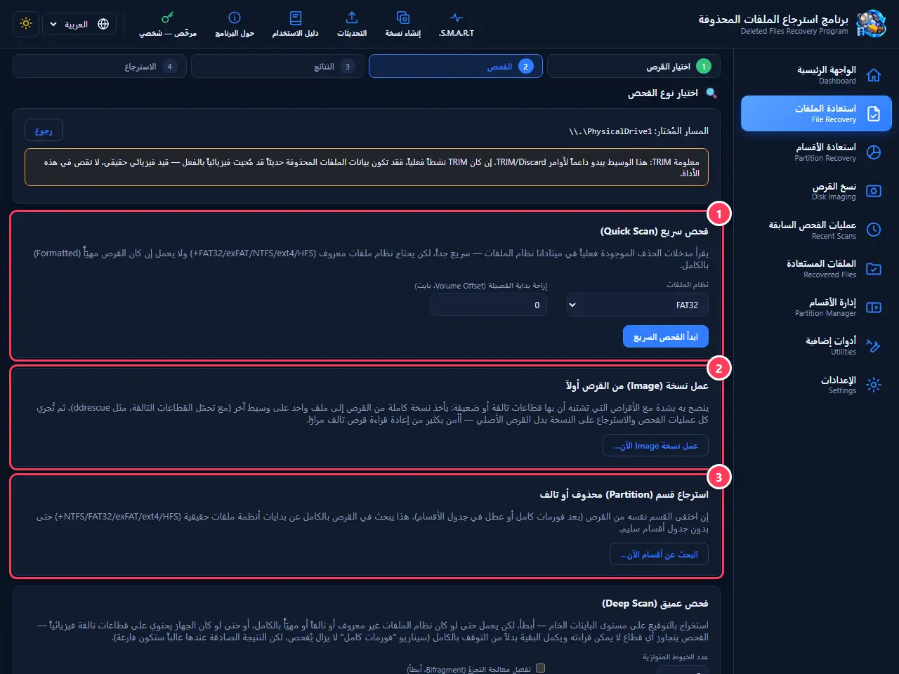

1. الفحص السريع: الأسرع، ويعيد الملفات بأسمائها الأصلية ومجلداتها. مناسب إذا حذفت الملفات حديثًا ولم تُهيّئ القرص.
2. عمل نسخة (Image) من القرص أولًا: مهم إذا كان القرص ضعيفًا أو يصدر أصواتًا أو بطيئًا جدًا. ينسخ القرص كله إلى ملف، ثم تفحص النسخة بدل القرص المتعب.
3. استرجاع قسم محذوف: إذا اختفى قسم كامل (مثلًا اختفى القرص D:).

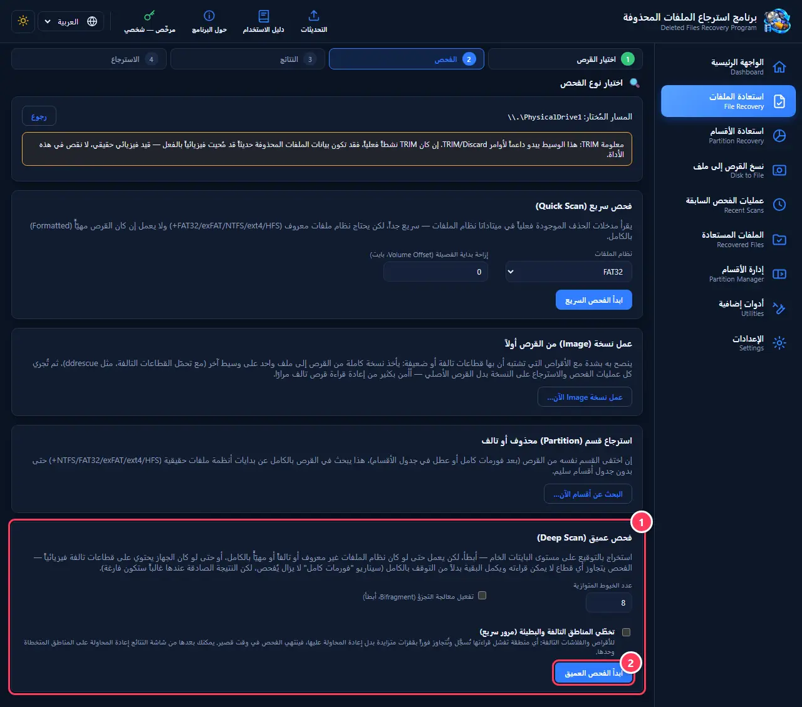

1. الفحص العميق: يبحث في القرص كله عن الملفات من «بصمتها» (صور، مستندات، فيديو…). يعمل حتى بعد الفورمات أو إذا تلف نظام الملفات، لكنه أبطأ ولا يعرف أسماء الملفات الأصلية.
2. اضغط «ابدأ الفحص العميق». خيار «تخطّي المناطق التالفة» مفيد للفلاشات والأقراص المتضررة.

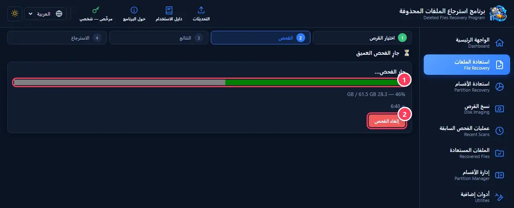

1. شريط التقدم والوقت المتبقي تقريبًا.
2. «إلغاء الفحص» يوقفه. يمكنك متابعة الفحص العميق لاحقًا من حيث توقف.

> **نصائح:**
> - ابدأ دائمًا بالفحص السريع؛ إذا لم تجد ملفاتك جرّب الفحص العميق.

[↑ العودة إلى المحتويات](#contents)

---

## 3. النتائج واسترجاع الملفات

بعد الفحص تظهر الملفات التي عُثر عليها. ابحث عن ملفاتك، عاينها، ثم استرجعها إلى مكان آمن.

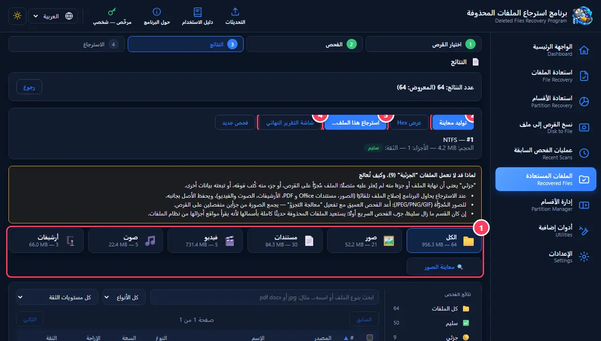

1. تصنيفات جاهزة: الكل، صور، مستندات، فيديو، صوت، أرشيفات — اضغط تصنيفًا لعرضه فقط. «معاينة الصور» تعرضها كصور مصغّرة.
2. «توليد معاينة» يعرض محتوى الملف المختار قبل استرجاعه.
3. «استرجاع» يحفظ الملف المختار (أو كل الملفات المحددة).
4. «شاشة التقرير النهائي» تصدّر قائمة الملفات PDF أو CSV.

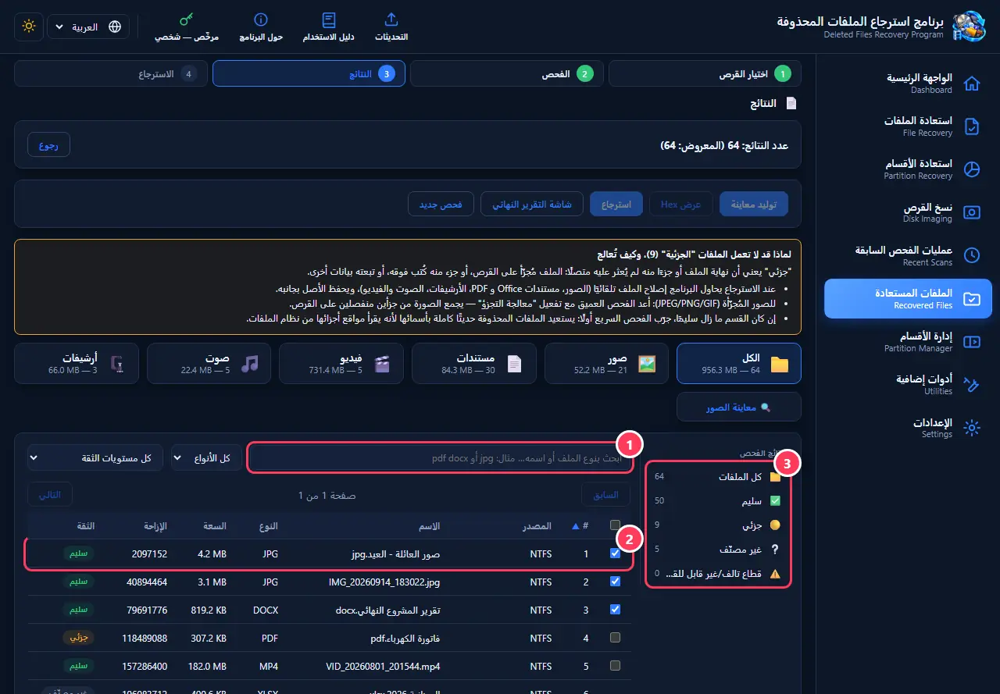

1. ابحث باسم الملف أو نوعه (مثل jpg أو pdf)، ورشّح حسب النوع وحالة الملف.
2. ضع علامة ✓ بجانب كل ملف تريده لاسترجاع عدة ملفات مرة واحدة.
3. شجرة النتائج: «سليم» يعني أن الملف كامل غالبًا، و«جزئي» أن جزءًا منه قد يكون تالفًا أو مكتوبًا فوقه.

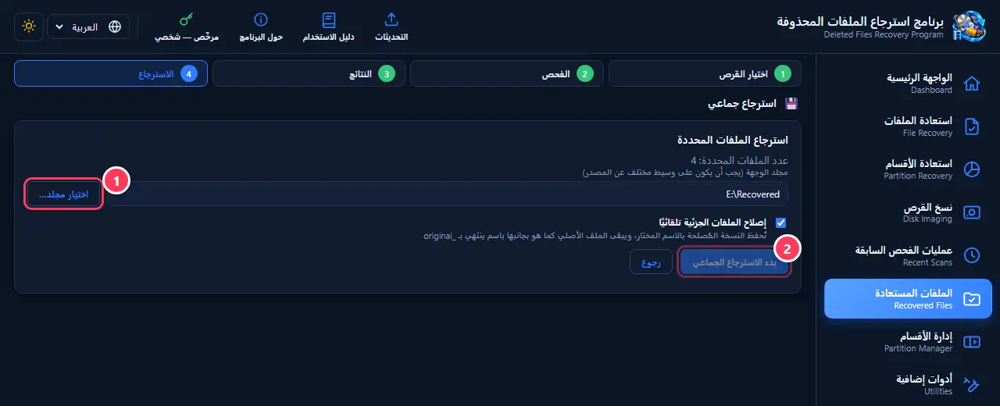

1. اختر مجلدًا للحفظ على قرص آخر (ليس القرص الذي تستعيد منه).
2. اضغط «بدء الاسترجاع الجماعي». يحاول البرنامج إصلاح الملفات الجزئية تلقائيًا ويحتفظ بالأصل بجانبها.

> **نصائح:**
> - احفظ الملفات المستعادة دائمًا على قرص مختلف — البرنامج ينبّهك إذا اخترت نفس القرص.

[↑ العودة إلى المحتويات](#contents)

---

## 4. استعادة الأقسام المفقودة

عندما يختفي قسم كامل (حرف مثل D: لم يعد يظهر، أو القرص يظهر «غير مخصص»)، يبحث البرنامج في القرص كله عن بدايات الأقسام القديمة.

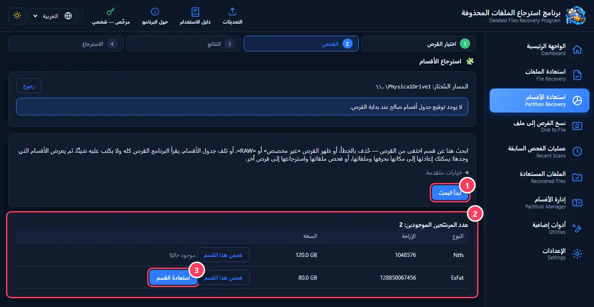

1. اضغط «ابدأ البحث» واترك الدقة كما هي.
2. تظهر الأقسام التي عُثر عليها بنوعها وحجمها. اضغط «فحص هذا القسم» لاستعراض ملفاته واسترجاعها.

[↑ العودة إلى المحتويات](#contents)

---

## 5. نسخ القرص إلى ملف (Image)

إذا كان القرص يتعطل أو بطيئًا جدًا، انسخه أولًا إلى ملف واحد على قرص سليم، ثم افحص الملف. هكذا لا يُرهق القرص التالف بالقراءة مرات كثيرة.

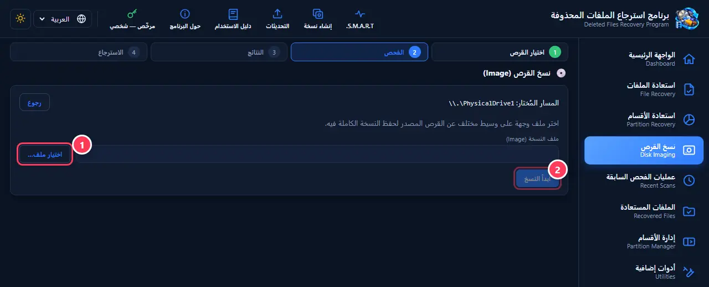

1. اختر مكان ملف النسخة على قرص آخر فيه مساحة كافية.
2. اضغط «ابدأ النسخ». بعد الانتهاء اضغط «فحص النسخة الآن».

> **نصائح:**
> - لفتح نسخة محفوظة لاحقًا: الواجهة الرئيسية ← «استعراض ملف صورة قرص».

[↑ العودة إلى المحتويات](#contents)

---

## 6. عمليات الفحص السابقة

يحفظ البرنامج نتائج آخر فحص، فتعود إليها دون إعادة الفحص حتى بعد إغلاق البرنامج.

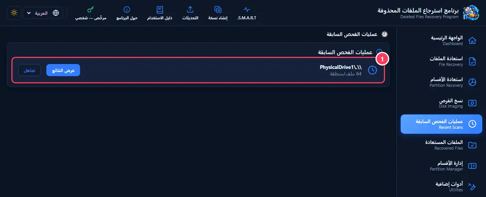

1. «عرض النتائج» يعيدك إلى الملفات التي عُثر عليها، و«تجاهل» يحذف هذه النتائج المحفوظة.

[↑ العودة إلى المحتويات](#contents)

---

## 7. إدارة الأقسام

لتقسيم قرص، أو تصغير قسم أو تكبيره، أو نقله، أو تهيئته وتغيير اسمه وحرفه. كل العمليات تتم عبر خدمة التخزين في ويندوز نفسها، وقرص النظام محمي من العمليات الخطرة.

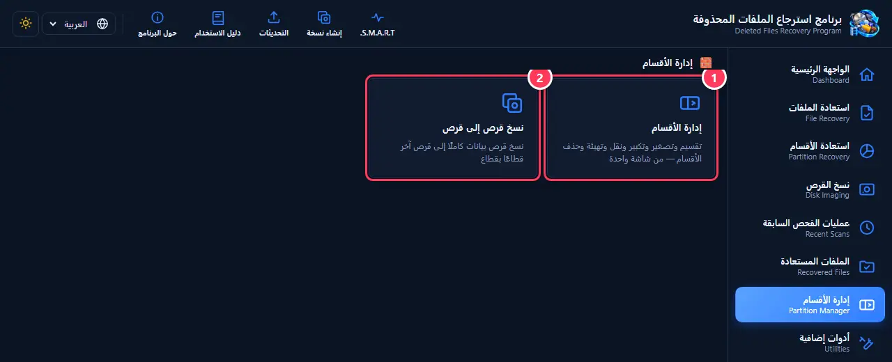

1. «إدارة الأقسام» لتعديل أقسام قرص.
2. «نسخ قرص إلى قرص» لنقل قرص كامل إلى قرص آخر.

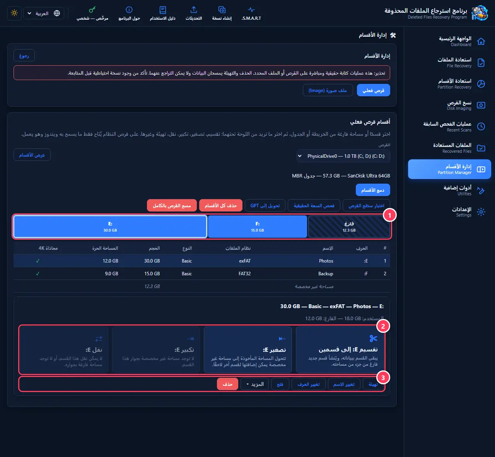

1. خريطة القرص: اضغط على قسم أو على مساحة «فارغ» لاختيارها.
2. بطاقات العمليات للقسم المختار: تقسيم إلى قسمين، تصغير، تكبير، نقل. البطاقة الباهتة غير متاحة الآن، ومكتوب تحتها السبب.
3. أزرار سريعة: تهيئة، تغيير الاسم، تغيير الحرف، فتح، و«المزيد»، وحذف القسم.

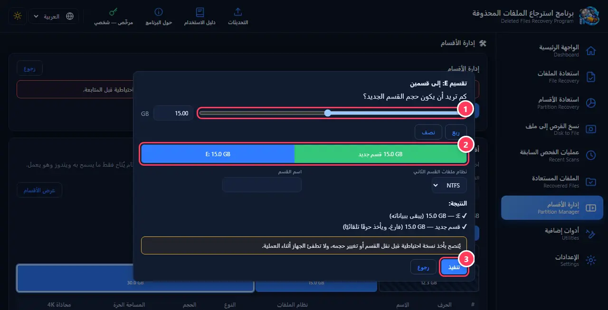

1. حرّك المؤشر أو اكتب الحجم بالجيجابايت (أو اضغط «ربع» أو «نصف»).
2. الشريط الملون يريك شكل القرص بعد العملية قبل تنفيذها.
3. اضغط «تنفيذ». لا تطفئ الجهاز أثناء العملية.

> **نصائح:**
> - خذ نسخة احتياطية من ملفاتك المهمة قبل نقل قسم أو تغيير حجمه.
> - إذا سمح ويندوز بتصغير قسم أقل من مساحته الفارغة، يشرح البرنامج السبب ويعرض حلًا عندما يكون ممكنًا.

[↑ العودة إلى المحتويات](#contents)

---

## 8. نسخ قرص إلى قرص

ينسخ قرص بيانات كاملًا (كل الأقسام والملفات) إلى قرص آخر — مثلًا عند الانتقال إلى قرص أكبر.

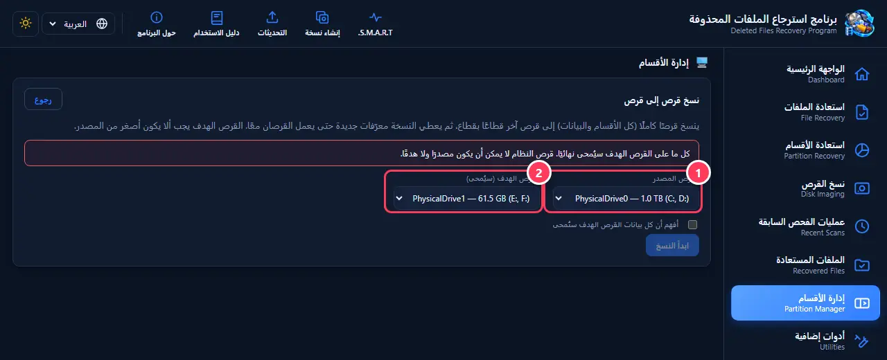

1. القرص المصدر: الذي تريد نسخه.
2. القرص الهدف: سيُمحى كل ما عليه ويصبح نسخة من المصدر، ويجب ألا يكون أصغر منه.

> **نصائح:**
> - تأكد مرتين من اختيار القرص الهدف الصحيح — محتواه يُمحى نهائيًا.

[↑ العودة إلى المحتويات](#contents)

---

## 9. الأدوات الإضافية

أدوات لفحص صحة الأقراص والفلاشات وتنظيمها. أهمها:

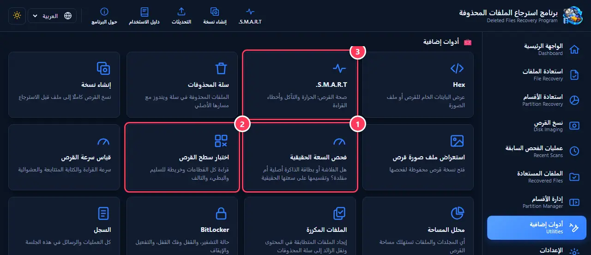

1. فحص السعة الحقيقية: هل الفلاشة أصلية أم مقلّدة؟
2. اختبار سطح القرص: يبحث عن الأماكن التالفة أو البطيئة.
3. S.M.A.R.T: صحة القرص وحرارته ونسبة تآكله.

[↑ العودة إلى المحتويات](#contents)

---

## 10. فحص السعة الحقيقية (فلاشة مقلدة؟)

بعض الفلاشات وبطاقات الذاكرة تُباع بسعة غير حقيقية: مكتوب عليها 32GB وفيها 8 أو 16 فقط. تعمل في البداية، ثم تتلف الملفات أو تتوقف التهيئة في منتصفها. هذا الفحص يكشفها في دقائق.

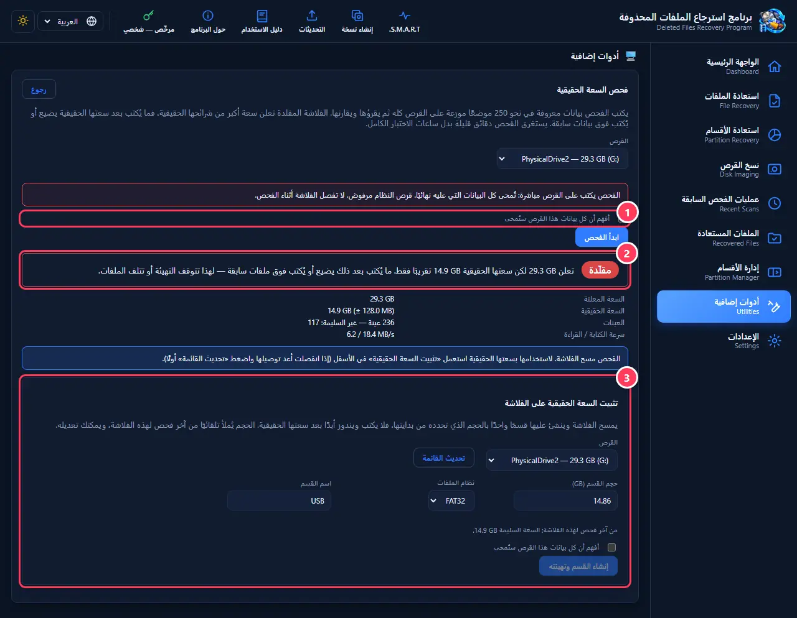

1. اختر الفلاشة، وضع علامة على «أفهم أن كل البيانات ستُمحى» (انسخ ملفاتك منها أولًا)، ثم «ابدأ الفحص».
2. النتيجة: أصلية، أو مقلّدة مع سعتها الحقيقية، أو تالفة جزئيًا، أو «توقفت عن الاستجابة».
3. «تثبيت السعة الحقيقية على الفلاشة»: يُملأ الحجم تلقائيًا من نتيجة الفحص. ضع العلامة واضغط «إنشاء القسم وتهيئته» فتستخدم الفلاشة سعتها الحقيقية فقط وتعمل بأمان. إذا انفصلت الفلاشة أثناء الفحص، أعد توصيلها واضغط «تحديث القائمة» أولًا.

[↑ العودة إلى المحتويات](#contents)

---

## 11. اختبار سطح القرص

يقرأ القرص كله ويرسم خريطة: أخضر سليم، أصفر بطيء، أحمر تالف. لا يغيّر أي شيء على القرص.

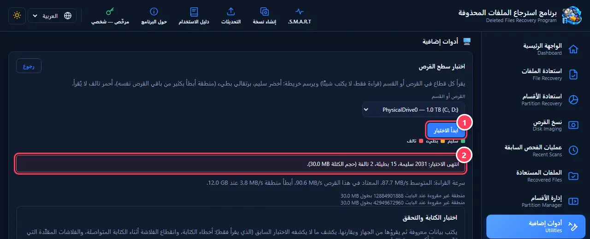

1. اختر القرص واضغط «ابدأ الاختبار».
2. الملخص: عدد المناطق السليمة والبطيئة والتالفة وأماكنها.

> **نصائح:**
> - إذا ظهرت مناطق تالفة، انسخ ملفاتك المهمة من القرص فورًا. وتحت الاختبار يوجد «اختبار الكتابة والتحقق» الأدق.

[↑ العودة إلى المحتويات](#contents)

---

## 12. صحة القرص S.M.A.R.T

معلومات يسجلها القرص عن نفسه: هل هو سليم، حرارته، نسبة تآكله (لأقراص SSD)، وعدد ساعات تشغيله.

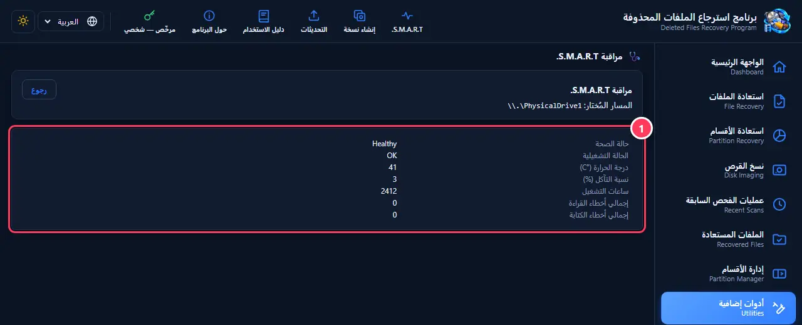

1. «Healthy» تعني سليم. انتبه إذا كانت الحرارة فوق 60° باستمرار، أو التآكل قريبًا من 100%، أو ظهرت أخطاء قراءة.

[↑ العودة إلى المحتويات](#contents)

---

## 13. قياس سرعة القرص

يقيس سرعة القراءة والكتابة الحقيقية للقرص أو الفلاشة بملف مؤقت يُحذف بعدها، دون المساس بملفاتك.

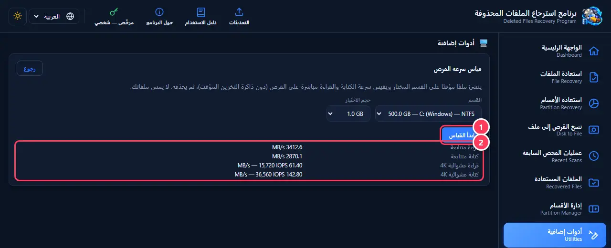

1. اختر القسم وحجم الاختبار، ثم «ابدأ القياس».
2. النتائج: السرعة المتتابعة (نسخ ملفات كبيرة) والعشوائية (تشغيل البرامج).

[↑ العودة إلى المحتويات](#contents)

---

## 14. محلل المساحة

يعرض أي المجلدات والملفات تستهلك مساحة القرص، لتعرف ماذا تحذف أو تنقل عندما يمتلئ.

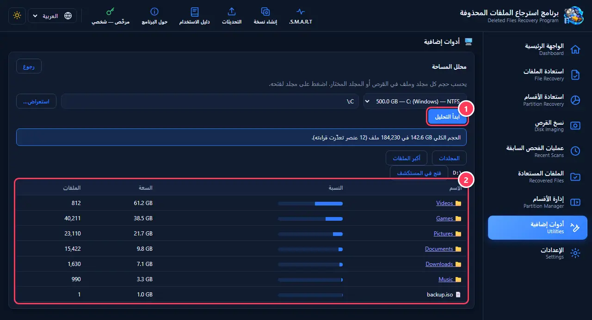

1. اختر القرص أو المجلد واضغط «ابدأ التحليل».
2. المجلدات مرتبة من الأكبر. اضغط على مجلد للدخول إليه.

[↑ العودة إلى المحتويات](#contents)

---

## 15. الملفات المكررة

يجد الملفات المتطابقة في المحتوى حتى لو اختلفت أسماؤها، ويوفّر المساحة بنقل النسخ الزائدة إلى سلة المحذوفات.

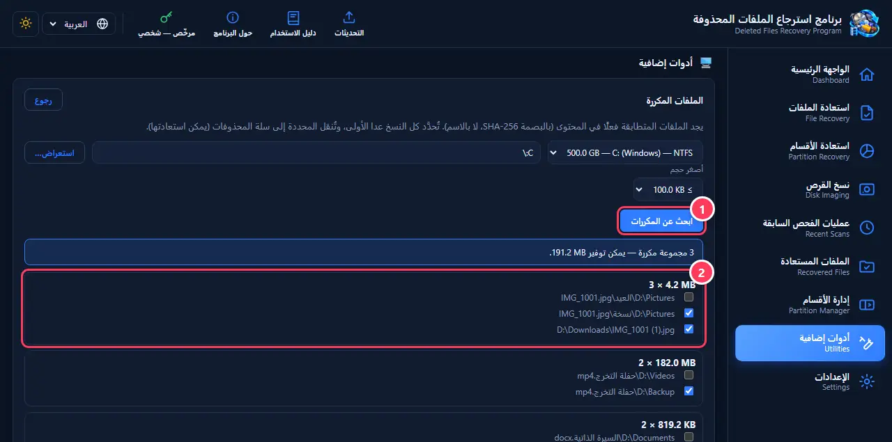

1. اختر القرص أو المجلد واضغط «ابحث عن المكررات».
2. في كل مجموعة تُحدَّد النسخ الزائدة تلقائيًا وتبقى نسخة واحدة؛ راجعها ثم انقلها إلى سلة المحذوفات.

> **نصائح:**
> - النقل إلى سلة المحذوفات وليس حذفًا نهائيًا، فيمكنك التراجع من سلة ويندوز.

[↑ العودة إلى المحتويات](#contents)

---

## 16. BitLocker (تشفير القرص)

يعرض هل القسم مشفّر بـ BitLocker، ويتيح قفله وفتحه وتفعيل التشفير أو إيقافه.

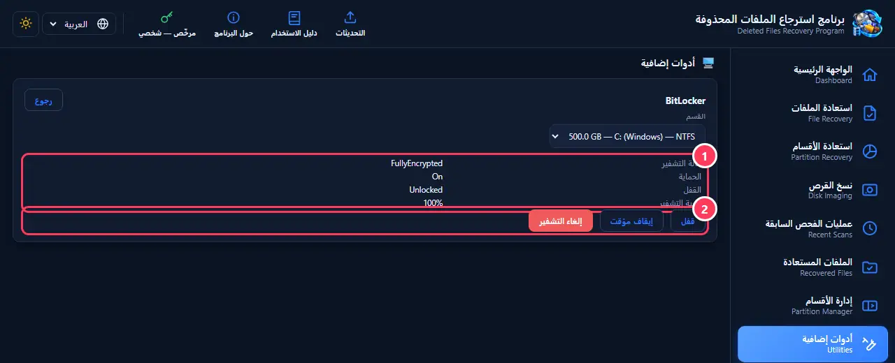

1. حالة التشفير والحماية والقفل ونسبة التشفير.
2. أزرار القفل، والإيقاف المؤقت، وإلغاء التشفير.

> **نصائح:**
> - احتفظ بمفتاح الاسترداد (Recovery Key) في مكان آمن قبل تفعيل التشفير.

[↑ العودة إلى المحتويات](#contents)

---

## 17. سلة المحذوفات

يعرض محتوى سلة محذوفات ويندوز مع المسار الأصلي لكل ملف وتاريخ حذفه، ويعيد أي ملف منها.

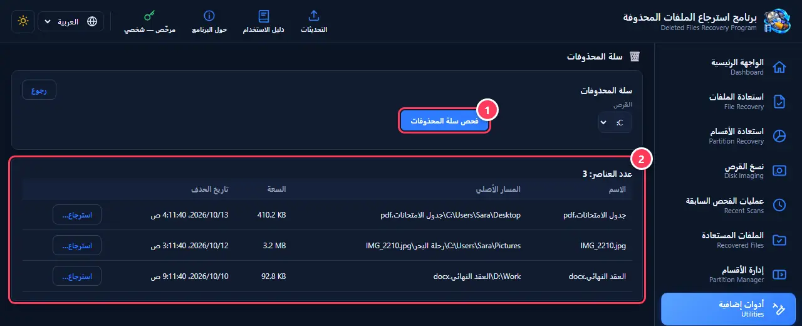

1. اختر القرص واضغط «فحص سلة المحذوفات».
2. اضغط «استرجاع…» بجانب الملف لحفظه.

[↑ العودة إلى المحتويات](#contents)

---

## 18. الإعدادات والتحديثات

لغة البرنامج ومظهره، والتحقق من التحديثات، ورقم الإصدار، وإدارة الترخيص.

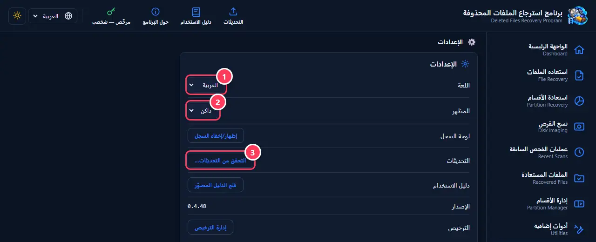

1. اللغة: العربية أو الإنجليزية، وتبقى كما اخترتها بعد التحديثات.
2. المظهر: فاتح أو داكن.
3. «التحقق من التحديثات»: يخبرك إذا صدر إصدار أحدث وينزّله.

> **نصائح:**
> - عند تشغيل البرنامج يظهر تنبيه تلقائي إذا وُجد تحديث جديد.
> - زر «الترخيص» (رمز المفتاح) في الشريط العلوي يعرض نوع ترخيصك، ومنه تفعّل البرنامج أو تلصق مفتاح ترقية إذا اشتريت إصدارًا أعلى.

[↑ العودة إلى المحتويات](#contents)

---

